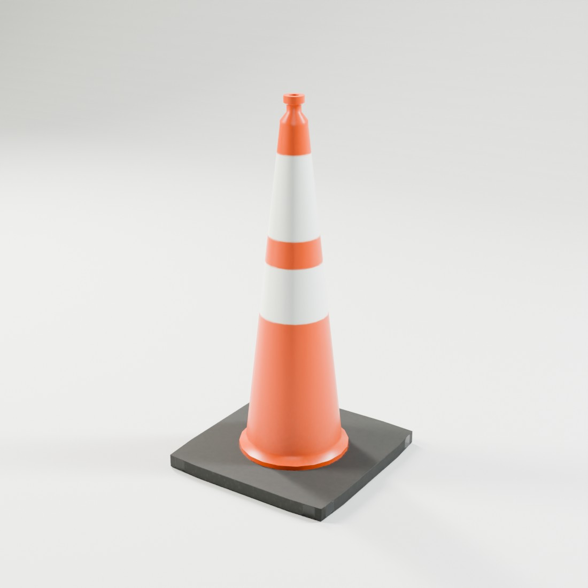
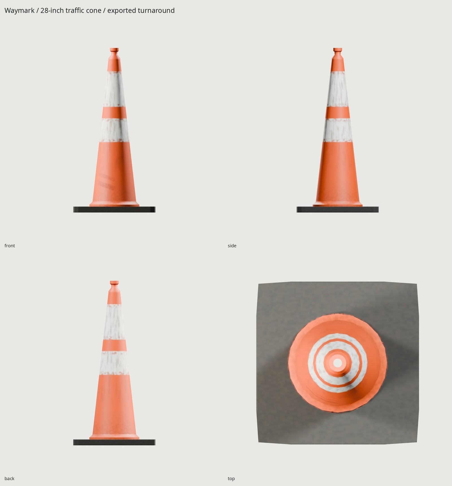
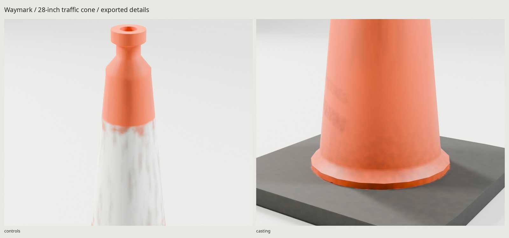

# Waymark / 28-inch traffic cone

An original hollow slim-body PVC traffic cone, with a weighted black square base,
recessed open grip, and 6-inch/4-inch reflective collars. The real opening passes
through the base and shell. The round silhouette and stacking bore get geometry;
small flutes, mould grain, foil seams and scuffs go into the baked normal map.



**355.6 × 355.6 × 711.2 mm**, from the cited 14 × 14 × 28 inch specification.
Collars occupy Z **457.2–609.6 mm** and **304.8–406.4 mm**, with a **50.8 mm** gap.
[REFERENCE.md](REFERENCE.md) separates measured dimensions from authored shell,
foot and base construction. No moving parts, pivots, sockets or armature.
Origin is the base's ground center, Blender +Z up / −Y front; glTF +Y up / +Z front.



**872 triangles**, one material / one static mesh, **499,956-byte GLB**.
UV coverage is **49.88%** (exact final report is in `build/delivery-check.json`),
with zero measured UV overlaps.

One **512² BaseColor / OpenGL +Y Normal / ORM** atlas, GPU-baked at 4096² with a
16-bit normal intermediate. ORM is R occlusion, G roughness, B metallic. Approximate
BC7/BC5-class compressed texture cost including mipmaps: **1 MiB**. `WEAR=.55`
represents suburban road use: dulled PVC, low skirt splash, dragged base edges,
short rubber-transfer marks, grip handling, and worn/dirty collar film. `WEAR=0` retains the manufacturing surface only.

The PVC is dielectric; reflective foil has a different satin response. Standard
glTF PBR approximates fluorescence and retroreflection. An engine-specific
view/light shader is needed for calibrated headlight return. The prop does not
simulate crushing or flexing, and is not certified traffic-control equipment.



```sh
make                         # refs, geometry, atlas, bake, GLB, studio, docs and checks
make check                   # source/game, UV, scale, normals, GLB and support surfaces
make photo                   # extract the cited PDF's product photograph (Poppler)
make PASS=review match       # source/photo comparison
make PASS=review match-final # exported-GLB/photo comparison
make WEAR=.8                 # dirtier rebuild
make clean && make           # reproduce delivery from scripts
```

Needs the installed Blender 5.2.2, Python/Pillow/NumPy, flock and Poppler pdfimages
for the PDF photograph. All geometry and texels are authored here; no third-party
asset or reference pixel enters the model/material. Procedural area lights only.

`export/TrafficCone.glb` embeds the three maps. `textures/bake/` and `textures/ship/`
are 4096/512. `renders/final/contact.jpg` contains the Cycles hero, four orthographic
views, two close-ups, 1.8 m human scale and Eevee last. Shot metadata records the
exported GLB SHA-256. `build/delivery-check.json` proves serialization/UV/PBR;
`build/assembly-check.json` separately measures the actual base/body contact.
`build/stack-check.json` tests two imported meshes: first clear pitch **83.346 mm**,
demonstrated pitch **83.446 mm** including 0.1 mm safety margin. It also ray-tests
336 wall sections; the minimum sampled radial thickness is **2.509 mm**. These
are physical mesh tests, distinct from serialization; they do not simulate flex.
[REVIEW.md](REVIEW.md) records both source and shipped photo critique.

The 512 set softens tiny grip and foil detail; the low radial count can be seen
at extreme close range. The used-photo pair `renders/wear-pass2-glb/used_campus-pair.jpg` calibrates
moderate sleeve abrasion and base scuffing (15.93 px landmark RMS). The reference
has a taped neck, different foot and stronger outdoor saturation; these are not
copied. The severe `used_roadside` comparison is an upper wear limit, not the
few-seasons target. Those and the 512 filtering are the main compromises.

Delivered PNG bytes are BaseColor **224,662**, Normal **83,999**, ORM **143,583**.
The coarse base corner chords require a 5 mm cage / 12 mm ray reach to meet the
high source; no geometry or UV adjustment is involved. All five 4096 bake
channels now report zero missed interior samples across the 8,212,941-texel
interior mask, and BaseColor has zero black interior samples.
