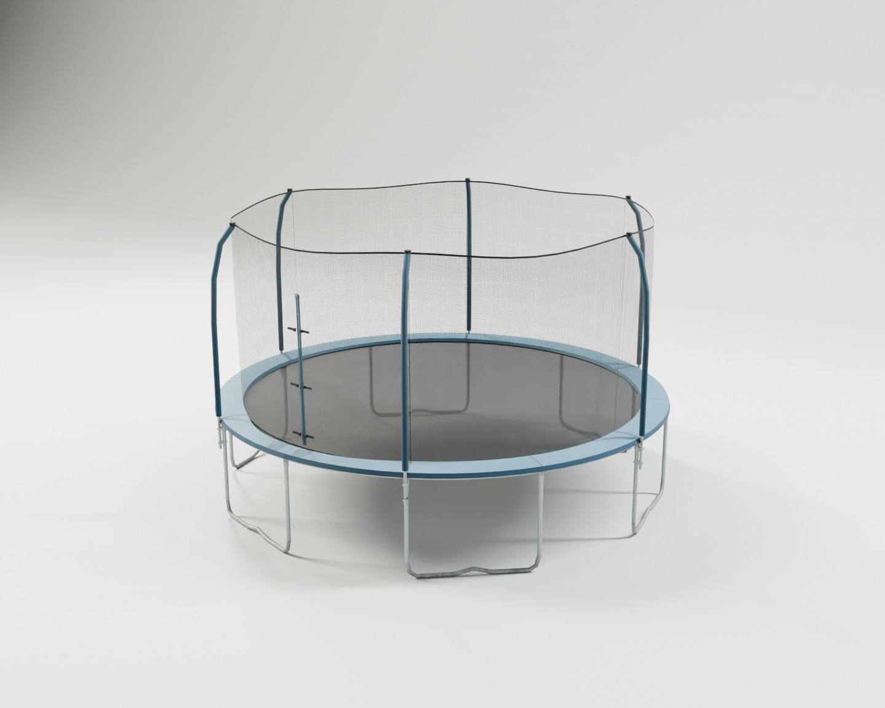
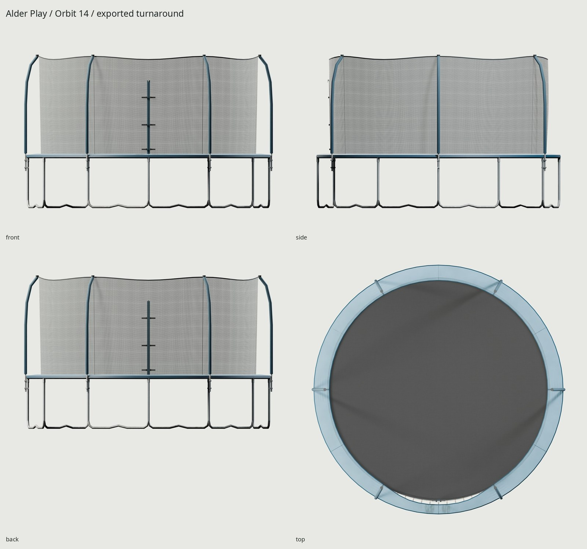
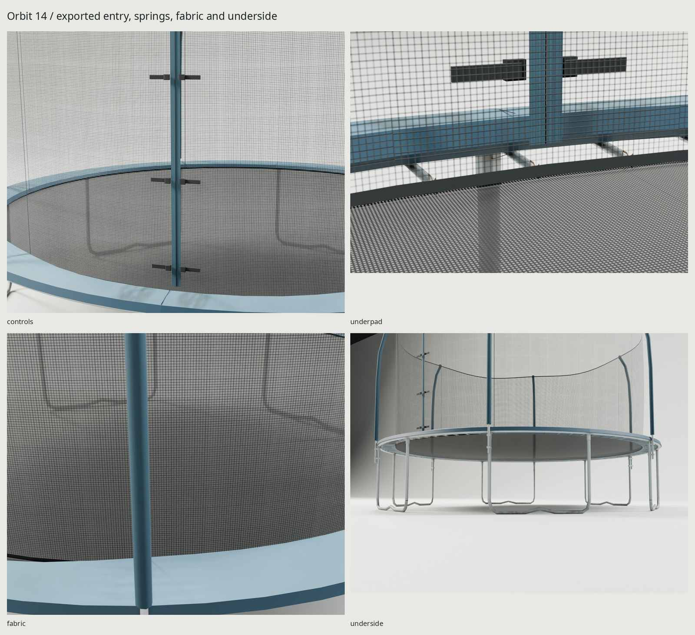

# Orbit 14

An original 14 ft backyard trampoline with six galvanized W legs, blue sewn padding, foam-covered enclosure poles, a slightly sagged net, woven jump mat and zippered entry. The design name and palette are fictional; no real branding or downloaded asset pixels ship.





## Dimensions and construction

| Element | Dimensions / count |
| --- | --- |
| Outside steel frame | 4.2672 m / 14 ft diameter |
| Frame and bed elevation | 0.890 m; bed center has 18 mm unloaded sag |
| Jump mat | 3.810 m diameter |
| Overall envelope | Approximately 4.3612 × 4.2912 × 2.690 m; pole sleeves extend past nominal frame |
| Steel frame / legs | 38 mm OD; twelve swaged frame sections, six W braces, twelve leg extensions |
| Enclosure | Six 25.4 mm poles with 52 mm foam sleeves; shaped inward above the pad |
| Net | Base radius 1.885 m; up to 55 mm upper-hem sag and 26 mm radial bagging between poles |
| Springs | 84 crossed analytic card pairs; installed card span 190 mm, coil OD 16 mm |
| Padding | Twelve sewn panels; approximately 274 mm radial width, with a small rolled-back front inner lip |

The manufacturer manual supplies the six-leg/84-spring assembly pattern; published product specifications supply the 14 ft class, frame height and tube size. Mat, pole gauge, weave, spring proportions and aging shape are original fitted choices. See [REFERENCE.md](REFERENCE.md) for exact source distinctions, and [credits](refs/SOURCES.md).

W braces have real tube diameter and two flats meeting grade, with raised center bends. Side clamps carry enclosure poles next to the leg extensions; caps and top ties support the upper net. The lower net is laced into sewn mat webbing. Three auxiliary buckle pairs rest released alongside the closed zipper. The source contains small bolt/swage detail for baking; hidden tube bores are omitted in the delivered mesh. The pad's rolled lip exposes a few installed coils without removing the cover.

## Delivery and cost

**7,922 triangles**, with a maximum budget of 8,000. One shared **1024²** BaseColor / OpenGL +Y Normal / ORM set, baked at 4096; BaseColor includes alpha. Estimated block-compressed GPU allocation is **about 4 MB** with mipmaps. There is no separate alpha image. Net, mat and spring pixels are generated analytically into reserved regions; all unique coated geometry stays in a separate nonoverlapping atlas rectangle.

The opaque assembly and slider use the atlas material; the static fabric assembly uses fractional BLEND alpha from those same three images. It includes mat, net and crossed spring cards, retaining useful thread coverage when the weave becomes subpixel. Engines should render this material through their normal transparent pass. This avoids a hard alpha cutoff making the net disappear. No armature or cloth simulation is included.

The export uses **two materials and three meshes** (fixed body, fixed fabrics/impostors and slider). GLB size is **1,871,324 bytes** (1.87 MB). Unique-island coverage is 23.79%; the three deliberately repeated tiles occupy another 14.06% of the atlas. Unique density p5 / median / p95 is 71.11 / 163.08 / 165.32 px/m: small bindings receive less than the exposed pad. The mat is about 1,000 px/m, the net 1,007–1,032 px/m and springs 1,695 px/m. Zero unique UV overlaps, outside triangles or degenerate triangles are permitted; intentional reuse is confined to the declared tile region.

Ground contact measures exactly 0 m at the W-brace vertices. The measured frame diameter is 4.2672002 m. At the sampled angle-zero spring, retained alpha pixel centers overlap the mat webbing by 1.63 mm and reach 3.03 mm into the frame silhouette. That pixel/surface check is separate from serialization; it does not claim a solid helix mesh or continuous cloth physics.

Coordinates are meters, +Z up / −Y front in Blender; glTF export is +Y up / +Z forward. Origin is at footprint center on grade. Fixed geometry consolidates into a body and fabric mesh; only `ZipSlider` moves. Its pivot is at approximately `(0, −1.9235, 2.240)` m, with local +Z tilted about +X to follow the zip track. Blender-local travel is **−1.28 to 0 m**, closed at 0; a 40 mm sampled sweep checks actual high/game solids. This moves the slider only: opening and dynamically deforming the net requires engine cloth or a separate authored variant. The three auxiliary buckles are deliberately released in the rest pose.

## Look development

`WEAR=.65` controls sun fading concentrated on the upward-facing pad, with much less on its sides and protected underside. Directional shoe/knee scuffs and seam-held grime stay beside the front zip entry. Soil deposits roughen and darken the feet and lower 200 mm of frame; zinc corrosion stays around sockets/welds and spring-hook oxide stays at the hooks. Foam fading follows exposure height. Sewing compression and small geometric puffs break up the cover. All material fields and tiles are original; photos supply comparison only. No worn grass or ground geometry ships.

## Rebuild and evidence

```sh
make
make check
make match PASS=source-final WIDTH=1100 SAMPLES=32
make match-final PASS=delivery-review WIDTH=1100 SAMPLES=32
```

Outputs: `build/lookdev.blend`, `build/finalized.blend`, `textures/{bake,ship}/`, `export/Trampoline.glb`. The complete contact sheet is **`renders/final/contact.jpg`**. Final Cycles hero, front/side/back/top, entry, fittings, fabric, exposed springs, underside and 1.8 m scale views are in `renders/final/`; Eevee is in `renders/final-eevee/`.

`make check` independently audits source/game geometry and normals, tile bounds/density, unique UV overlap, exported alpha modes/images, applied transforms and re-import. Physical evidence is separate: sampled zipper travel, support-surface intersections, ground-contact vertices, frame diameter, and retained spring-alpha endpoints reaching the mat webbing/frame. Reports stay in `build/`. [REVIEW.md](REVIEW.md) records the two critique passes and remaining limits. Only the three final JPGs above are committed.

Reference photograph: Nayand, CC BY-SA 3.0. Local photographic composites retain that license and include a credit file. The delivered textures and committed documentation contain only our own pixels.
