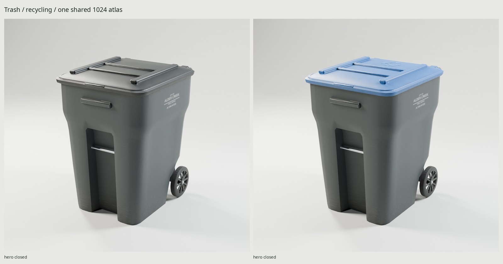
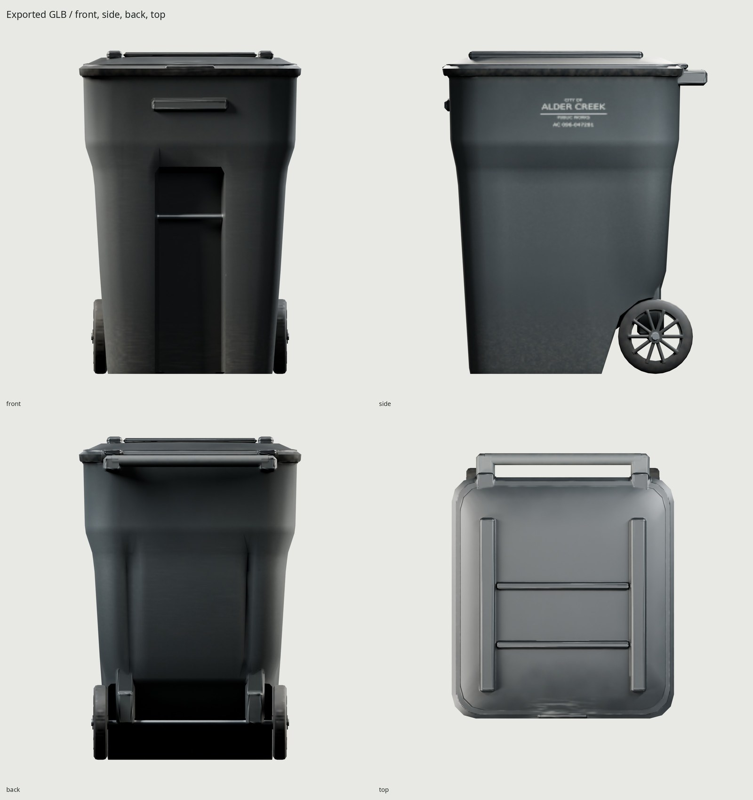
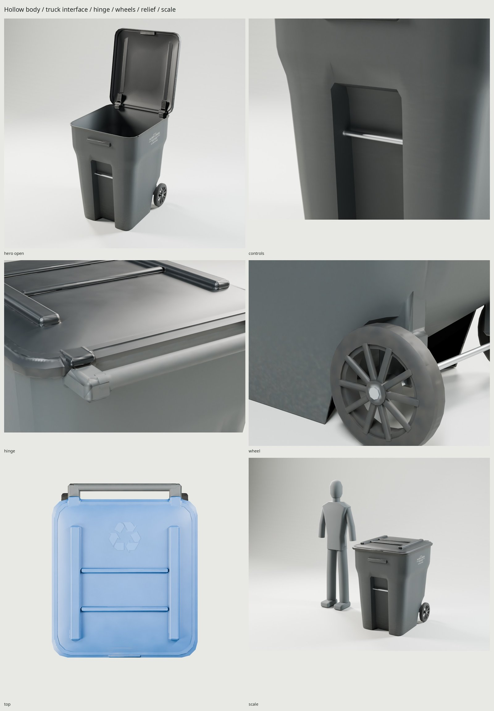

# Alder Creek / 96-gallon wheeled trash cart

An original American municipal roll-out cart for automated pickup. A sun-faded
charcoal body carries either a black trash lid or a blue recycling lid with a
molded recycling symbol. Fictional City of Alder Creek hot stamps and the serial
**AC 096-047281** identify both variants. Every vertex and texel is scripted here.



The body is a continuous thick-walled rotomolded HDPE shell with a recessed
front lifting channel, steel catch bar, broad upper lifting saddle,
side gripper shoulders, molded rear reinforcement and closed wheel-well floor.
The lid has a thin crowned skin, returned skirt, stepped sealing bead, ribs,
front lifting tab and two pin hinges. Two open-web molded wheels turn on a zinc-
plated steel axle carried by gusseted journals. The integral rear grip has real
hand clearance. The interior remains modeled for open-lid use.

[REFERENCE.md](REFERENCE.md) records manufacturer dimensions and authored
construction estimates. [refs/SOURCES.md](refs/SOURCES.md) credits photographs
and literature; [REVIEW.md](REVIEW.md) records the two photo critique passes.

| Measurement | Reference | Generated |
| --- | --- | --- |
| Width | 29¾ in / 755.65 mm | 755.65 mm |
| Depth, rear grip included | 35½ in / 901.70 mm | 901.70 mm |
| Closed height | 43¼ in / 1098.55 mm | 1098.55 mm |
| Wheel diameter | 10 in / 254 mm | 254 mm |
| Steel axle diameter | 5/8 in / 15.875 mm | 15.875 mm |
| Body / lid skin | Authored estimate | 6 / 5 mm |

The current manufacturer specification page controls the envelope. Its brochure
prints a different 43½-inch revision; that height is not mixed into this model.
The reference maker calls its resin MDPE, while this fictional cart follows the
brief's HDPE specification. Capacity is the nominal 96-US-gallon product class,
not an independently certified interior-volume or truck-interface specification.



| Delivery measurement | Result |
| --- | --- |
| Trash / recycling triangles | 5,556 / 5,776, each within 6,000 |
| Mesh objects / materials | 4 / 1 |
| Shared atlas | Three 1024² PNGs; 4096² source bake |
| Block-compressed GPU memory | Approximately 4 MB with mipmaps, shared across both variants |
| Trash / recycling GLB bytes | 2,387,504 / 2,409,624 |
| BaseColor / Normal / ORM PNG bytes | 736,541 / 486,758 / 825,586 |
| Trash / recycling UV coverage | 42.41% / 42.52% |
| UV density p5 / median / p95 | 200 / 236 / 238 px/m at 1024 |

BaseColor is sRGB; tangent Normal is OpenGL +Y; ORM packs R occlusion,
G roughness and B metallic. The normal intermediate is 16-bit at 4096. Delivery
filtering averages BaseColor in linear light, renormalizes normal vectors and
uses RMS roughness. The GLBs embed byte-identical images from one atlas; an
engine should share the material/textures when loading both files. PNG file
compression is separate from engine GPU block compression.

`WEAR=0.35` represents ordinary suburban use: upper/exposed resin fades in sun,
road grit concentrates below the splash line, dirt collects at the lid lip,
water trails descend from the lifting shoulder, and scuffs follow truck contact,
drag heels and hand contact. Manufacturing grain remains at `WEAR=0`; all use
weathering scales with the variable. Tread, grain, small edge detail and the municipal hot stamp are carried by the
bake. The large 16 cm molded recycling symbol retains 220 triangles so its
required identification remains clear at this atlas resolution, without another
mesh object, material or texture set.



Authoring is meters, Blender +Z up, front −Y. The origin is the center of the
actual ground-contact footprint at Z=0. glTF maps Blender `(x,y,z)` to
`(x,z,−y)`. Static body, bar, grip and axle consolidate into one mesh. The lid
and each wheel remain separate meshes under their pivot empties; no armature or
animation clips are required for engine control.

| Pivot | Blender position, mm | Axis / range |
| --- | --- | --- |
| `TrashCart` | (0, 0, 0) | Placement origin |
| `Lid` | (0, 391.075, 1032) | X; 0° closed through −110° open |
| `Wheel_Left` | (−305, 314.925, 127) | X; continuous rotation |
| `Wheel_Right` | (305, 314.925, 127) | X; continuous rotation |

Installed Blender 5.2.2, Python/Pillow/NumPy, DejaVu Sans, flock are required; an OptiX or
CUDA GPU is recommended (otherwise Cycles warns and uses the CPU). No packages or remote code are installed. References are
only images/PDFs; studio lighting uses procedural area lights. All Cycles work
holds `ASSETS_GPU_LOCK`. Scratch files live in ignored `build/` directories.

```sh
make                         # references, source, UVs, 4K bake, both GLBs, final renders, docs, checks
make check                   # audits, camera projection, both GLBs, shared atlas and moving parts
make variant VARIANT=trash
make variant VARIANT=recycling
make WEAR=0.65                # regenerate a more weathered pair
make match PASS=photo-review WIDTH=1100 SAMPLES=32
make preview                 # Workbench source views
make clean && make           # complete rebuild
```

The alternate blue lid is staged 1.25 m to the right only for non-overlapping
baking. Variant export removes the unused lid and restores the selected hinge
position/name. Thus the source audit counts both lids (6,816 game-source
triangles), whereas the 6,000-triangle delivery gate applies independently to
each exported cart. Both variants use the same body geometry and UVs.

| Local rebuilt output | Contents |
| --- | --- |
| `export/TrashCart.glb` | Trash variant |
| `export/TrashCartRecycling.glb` | Recycling variant, shared atlas |
| `textures/bake/`, `textures/ship/` | 4096 bake, 1024 delivery, reports |
| `build/*audit.json`, `uv-report.json` | Source topology, scale, budgets, packed UV measurements |
| `build/*delivery-check.json`, `cart-check.json` | Independent GLB accessors/re-import, texture identity, origin and pivot exercise |
| `renders/final/contact.jpg` | All final views including recycling, scale and Eevee |
| `renders/final/`, `renders/recycling/`, `renders/final-eevee/` | Exported-GLB images and source SHA-256 metadata |
| `renders/pass1/`, `renders/pass2/`, `renders/final-photo/` | Ignored photographed comparisons and calibration residuals |
| `docs/` | Three final JPGs, each ≤1600 px wide and ≤200 KB |

The weakest area is close-range texture resolution: a shared 1024 atlas softens
fine resin grain, tread and serial lettering. The authored wheel wells and
shoulder blends are simpler than the photographed mold, and the lid's broad
studio reflection differs from the catalog photo. These are original variants
within measured dimensions, not a manufacturing-exact replica. Close hinge and lid views also expose some baked-normal waviness.

Original scripts, geometry, procedural finishes and fictional graphics are authored
in this repository. DejaVu Sans uses its open font license; the recycling symbol
is a standard mark. Reference photographs remain copyrighted measurement aids,
ignored by Git and absent from the textures and documentation images.
