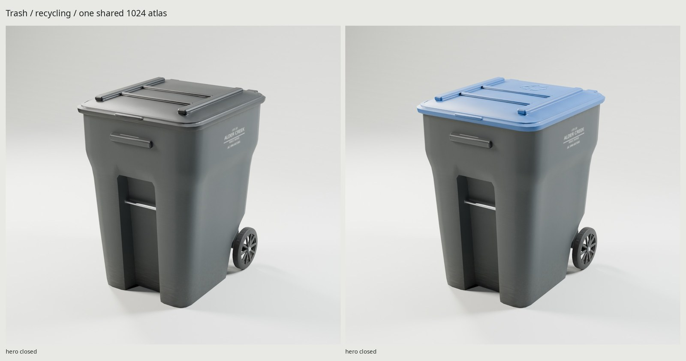
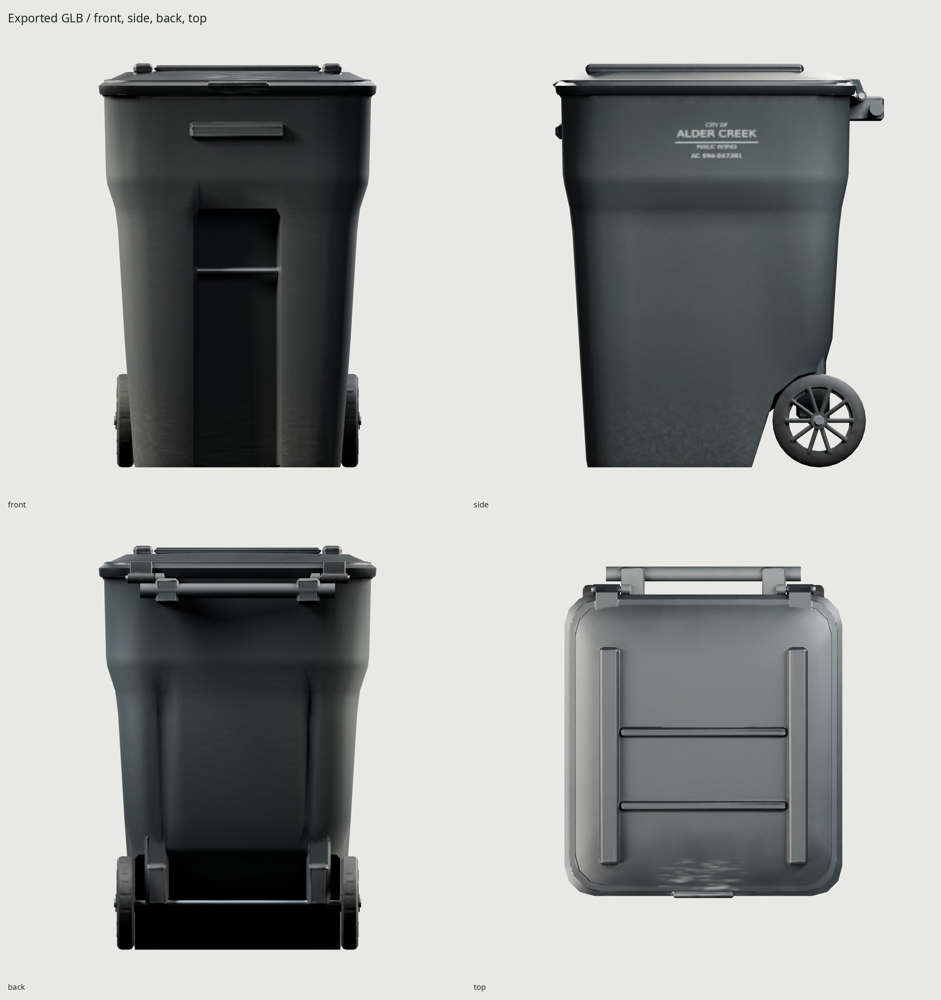
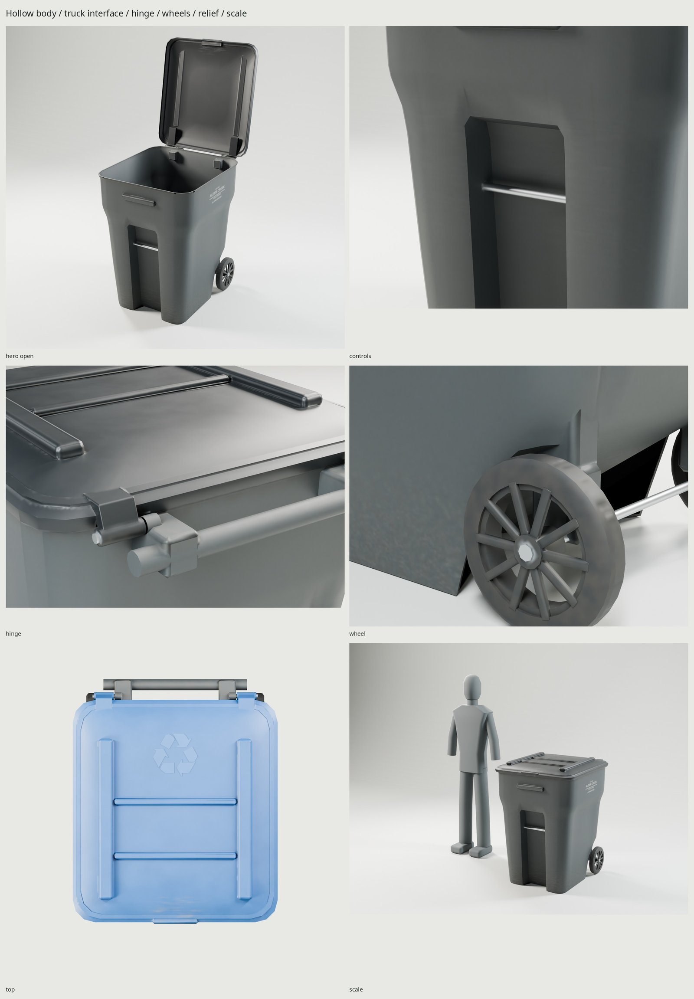

# Alder Creek / 96-gallon wheeled trash cart

An original American municipal roll-out cart for automated pickup. A sun-faded
charcoal body carries either a black trash lid or a blue recycling lid with a
molded recycling symbol. Fictional City of Alder Creek hot stamps and the serial
**AC 096-047281** identify both variants. Every vertex and texel is scripted here.



The body is a continuous thick-walled rotomolded HDPE shell with a recessed
front lifting channel, steel catch bar, broad upper lifting saddle,
side gripper shoulders, molded rear reinforcement and closed wheel-well floor.
The lid has a thin crowned skin, returned skirt, stepped sealing bead, ribs,
front lifting tab and two pin hinges. Two open-web molded wheels turn on a zinc-
plated steel axle carried by gusseted journals. The integral rear grip has real
hand clearance. The interior remains modeled for open-lid use.

[REFERENCE.md](REFERENCE.md) records manufacturer dimensions and authored
construction estimates. [refs/SOURCES.md](refs/SOURCES.md) credits photographs
and literature; [REVIEW.md](REVIEW.md) records the two photo critique passes.

| Measurement | Reference | Generated |
| --- | --- | --- |
| Width | 29¾ in / 755.65 mm | 755.65 mm |
| Depth, rear grip included | 35½ in / 901.70 mm | 901.70 mm |
| Closed height | 43¼ in / 1098.55 mm | 1098.55 mm |
| Wheel diameter | 10 in / 254 mm | 254 mm |
| Steel axle diameter | 5/8 in / 15.875 mm | 15.875 mm |
| Body / lid skin | Authored estimate | 6 / 5 mm |

The current manufacturer specification page controls the envelope. Its brochure
prints a different 43½-inch revision; that height is not mixed into this model.
The reference maker calls its resin MDPE, while this fictional cart follows the
brief's HDPE specification. Capacity is the nominal 96-US-gallon product class,
not an independently certified interior-volume or truck-interface specification.



| Delivery measurement | Result |
| --- | --- |
| Trash / recycling triangles | 5,724 / 5,944, each within 6,000 |
| Mesh objects / materials | 4 / 1 |
| Shared atlas | Three 1024² PNGs; 4096² source bake |
| Block-compressed GPU memory | Approximately 4 MB with mipmaps, shared across both variants |
| Trash / recycling GLB bytes | 2,558,388 / 2,580,844 |
| BaseColor / Normal / ORM PNG bytes | 792,744 / 525,974 / 897,541 |
| Trash / recycling UV coverage | 47.49% / 47.62% |
| UV density p5 / median / p95 | 212 / 249 / 252 px/m at 1024 |

BaseColor is sRGB; tangent Normal is OpenGL +Y; ORM packs R occlusion,
G roughness and B metallic. The normal intermediate is 16-bit at 4096. Delivery
filtering averages BaseColor in linear light, renormalizes normal vectors and
uses RMS roughness. The GLBs embed byte-identical images from one atlas; an
engine should share the material/textures when loading both files. PNG file
compression is separate from engine GPU block compression.

`WEAR=0.35` represents ordinary suburban use: upper/exposed resin fades in sun,
road grit concentrates below the splash line, dirt collects at the lid lip,
water trails descend from the lifting shoulder, and scuffs follow truck contact,
drag heels and hand contact. Manufacturing grain remains at `WEAR=0`; all use
weathering scales with the variable. Tread, grain, small edge detail and the municipal hot stamp are carried by the
bake. The large 16 cm molded recycling symbol retains 220 triangles so its
required identification remains clear at this atlas resolution, without another
mesh object, material or texture set.



Authoring is meters, Blender +Z up, front −Y. The origin is the center of the
actual ground-contact footprint at Z=0. glTF maps Blender `(x,y,z)` to
`(x,z,−y)`. Static body, bar, grip and axle consolidate into one mesh. The lid
and each wheel remain separate meshes under their pivot empties; no armature or
animation clips are required for engine control.

The external hinge uses bent straps and inboard fixed knuckles with a 3 mm
axial gap. The lower rear grip clears the fully open lid. `make check` sweeps
both delivered lids at 1° steps over the full range and each wheel at 5° steps,
allowing only finite pin/axle bearing contacts; every sampled pose must remain
within 0.2 mm unintended penetration. Source parts are also swept independently.
The [joint review](REVIEW.md#joint-repair--source-construction-2026-11-09)
records the construction changes and close views.

| Pivot | Blender position, mm | Axis / range |
| --- | --- | --- |
| `TrashCart` | (0, 0, 0) | Placement origin |
| `Lid` | (0, 430, 1010) | X; 0° closed through −110° open |
| `Wheel_Left` | (−305, 314.925, 127) | X; continuous rotation |
| `Wheel_Right` | (305, 314.925, 127) | X; continuous rotation |

Blender 5.2, Python/Pillow/NumPy, DejaVu Sans, flock are required; an OptiX or
CUDA GPU is recommended (otherwise Cycles warns and uses the CPU). No packages or remote code are installed. References are
only images/PDFs; studio lighting uses procedural area lights. All Cycles work
holds `ASSETS_GPU_LOCK`. Scratch files live in ignored `build/` directories.

```sh
make                         # references, source, UVs, 4K bake, both GLBs, final renders, docs, checks
make check                   # audits, camera projection, both GLBs, shared atlas and moving parts
make repeat                  # clean-scene source builds; exact finalized geometry, UVs, normals and frames
make joint-views             # both exported hinges closed, at -67 degrees, and fully open
make variant VARIANT=trash
make variant VARIANT=recycling
make WEAR=0.65                # regenerate a more weathered pair
make match PASS=photo-review WIDTH=1100 SAMPLES=32
make preview                 # Workbench source views
make clean && make           # complete rebuild
```

The alternate blue lid is staged 1.25 m to the right only for non-overlapping
baking. Variant export removes the unused lid and restores the selected hinge
position/name. Thus the source audit counts both lids (7,056 game-source
triangles), whereas the 6,000-triangle delivery gate applies independently to
each exported cart. Both variants use the same body geometry and UVs.

| Local rebuilt output | Contents |
| --- | --- |
| `export/TrashCart.glb` | Trash variant |
| `export/TrashCartRecycling.glb` | Recycling variant, shared atlas |
| `textures/bake/`, `textures/ship/` | 4096 bake, 1024 delivery, reports |
| `build/*audit.json`, `uv-report.json` | Source topology, scale, budgets, packed UV measurements |
| `build/*delivery-check.json`, `cart-check.json` | Independent GLB accessors/re-import, texture identity, origin and pivot exercise |
| `renders/final/contact.jpg` | All final views including recycling, scale and Eevee |
| `renders/final/`, `renders/recycling/`, `renders/final-eevee/` | Exported-GLB images and source SHA-256 metadata |
| `renders/pass1/`, `renders/pass2/`, `renders/final-photo/` | Ignored photographed comparisons and calibration residuals |
| `docs/` | Three final JPGs, each ≤1600 px wide and ≤200 KB |

The weakest area is close-range texture resolution: a shared 1024 atlas softens
fine resin grain, tread and serial lettering. The authored wheel wells and
shoulder blends are simpler than the photographed mold, and the lid's broad
studio reflection differs from the catalog photo. These are original variants
within measured dimensions, not a manufacturing-exact replica. Close hinge and lid views also expose some baked-normal waviness.

Original scripts, geometry, procedural finishes and fictional graphics are authored
in this repository. DejaVu Sans uses its open font license; the recycling symbol
is a standard mark. Reference photographs remain copyrighted measurement aids,
ignored by Git and absent from the textures and documentation images.

Both carts have one optional far LOD at 9% screen height (97.2 pixels at 1080p).
Run `make lod` and `make check-lod` for both kinds; the default build stays the
original delivery. Retain LOD0 until the lid and both wheels are in their
canonical rest pose, and restore LOD0 before changing any of those angles.
The reference selector is `src/check_lod_motion.py:selected_level`; the same
check verifies every original motion pose and each reduced rest pose.

Region protection preserves the thin lid reveal and the original atlas routing.
Both reductions miss their triangle targets; [REVIEW.md](REVIEW.md) explains
the measured tradeoff and cheaper visual failures. The shared 1024 atlas stays
resident once across both carts and all their levels. The tables below measure
stored alternatives; only one level is drawn per placed cart. The final chains
omit the extra near switch because its geometry was too similar to the far level.

<!-- LOD checkpoint trash: begin -->
## Trash cart LODs

`make lod` builds additional core glTF/BIN files and a manifest under `export/lod/trash/`; `make check-lod` checks them. The existing delivery is immutable LOD0. Default `make` and `make check` retain their original build graph.

| Level | Triangles / target | Materials / draw calls | Geometry bytes | PNG bytes | Total load bytes | GPU unique textures + mesh, MiB | Switch height / distance |
| --- | ---: | ---: | ---: | ---: | ---: | ---: | --- |
| LOD0 | 5,724 / — | 1 / 4 | 342,129 | 2,216,259 | 2,558,388 | 4.000 + 0.3206 | near |
| LOD1 | 3,998 / 859 | 1 / 4 | 289,546 | 2,216,259 | 2,505,805 | 4.000 + 0.2709 | 9.0% / 10.57 m |

Chain check: True; image check: True; normal check: True.


Whole-chain resident GPU estimate: **4.592 MiB**, versus LOD0 alone **4.321 MiB**. Unique textures 4.000 MiB = 4.000 MiB original + 0.000 MiB proxy/impostor; all meshes 0.5915 MiB. Increase over LOD0 0.271 MiB = 0.000 MiB far maps + 0.2709 MiB additional mesh buffers. Intermediate new images: 0. Bind intermediate primitives to the canonical LOD0 material resources; the manifest records full image hashes and source image indices. Identical embedded/external PNG bytes require this resource binding to share GPU allocations, including duplicate original image entries. GPU columns deduplicate complete image hashes within each row; PNG/dependency bytes retain physical payload copies. Optional camera-facing impostor is a separate alternative; engine overhead is excluded.

Distances are to the bound center at 60° vertical FOV / 1080p. GPU figures estimate 8-bpp block-compressed textures with full mips plus raw accessor mesh bytes, before engine overhead. Per-level map bytes describe dependencies, including reused originals. The whole-chain estimate deduplicates canonical image resources. Targets and achieved counts are reported separately; a count alone does not establish visual acceptance.

Load these files as alternatives and configure Godot visibility ranges, Unity LODGroup renderers, or Unreal mesh/component LODs. Keep matching near pivots in the same pose during switching. [Engine sources, pixel thresholds and texture policy](../kit/LOD.md).

Near levels consolidate static parts by material and simplify moving parts while retaining names, pivots, sockets and animation data. Intermediate levels preserve original charts, attributes and LOD0 materials. Only the proxy receives new charts baked from the immutable delivered maps and shaders. Intermediate levels allocate no additional images.

Native-pixel LOD0/adjacent strips, amplified differences, close views and measured image status: `renders/lod/trash/` (`contact.jpg`, `metrics.json`). Raw checks: `export/lod/trash/check.json` and `export/lod/trash/normals-vs-lod0.json`; per-level construction/pruning decisions: `build/lod/<source stem>/simplification.json` and manifest assembly receipts. [Critique, target misses and known failures](../kit/LOD_REVIEW.md).

Shipped PNG dimensions: LOD0: 3 × 1024×1024; LOD1: 3 × 1024×1024.

LOD1 separate moving meshes: `LidMesh`, `Wheel_LeftMesh`, `Wheel_RightMesh`.

Whole default chain:

| Stored mesh triangles | Material resources | Stored primitive placements | Distinct payload bytes | Resident GPU, MiB |
| ---: | ---: | ---: | ---: | ---: |
| 9,722 | 1 | 8 | 5,064,193 | 4.5916 |

Stored counts include the full immutable source container once and every default level; optional impostor alternatives are excluded. Near materials use their canonical source bindings. Physical payload files are counted once by path. Only one level is drawn per instance: active draw calls range from 4 to 4 across these kinds/levels. Stored primitive placements are not simultaneous runtime draw calls.

<!-- LOD checkpoint trash: end -->

<!-- LOD checkpoint recycling: begin -->
## Recycling cart LODs

`make lod` builds additional core glTF/BIN files and a manifest under `export/lod/recycling/`; `make check-lod` checks them. The existing delivery is immutable LOD0. Default `make` and `make check` retain their original build graph.

| Level | Triangles / target | Materials / draw calls | Geometry bytes | PNG bytes | Total load bytes | GPU unique textures + mesh, MiB | Switch height / distance |
| --- | ---: | ---: | ---: | ---: | ---: | ---: | --- |
| LOD0 | 5,944 / — | 1 / 4 | 364,585 | 2,216,259 | 2,580,844 | 4.000 + 0.3420 | near |
| LOD1 | 4,218 / 892 | 1 / 4 | 312,013 | 2,216,259 | 2,528,272 | 4.000 + 0.2922 | 9.0% / 10.57 m |

Chain check: True; image check: True; normal check: True.


Whole-chain resident GPU estimate: **4.634 MiB**, versus LOD0 alone **4.342 MiB**. Unique textures 4.000 MiB = 4.000 MiB original + 0.000 MiB proxy/impostor; all meshes 0.6342 MiB. Increase over LOD0 0.292 MiB = 0.000 MiB far maps + 0.2922 MiB additional mesh buffers. Intermediate new images: 0. Bind intermediate primitives to the canonical LOD0 material resources; the manifest records full image hashes and source image indices. Identical embedded/external PNG bytes require this resource binding to share GPU allocations, including duplicate original image entries. GPU columns deduplicate complete image hashes within each row; PNG/dependency bytes retain physical payload copies. Optional camera-facing impostor is a separate alternative; engine overhead is excluded.

Distances are to the bound center at 60° vertical FOV / 1080p. GPU figures estimate 8-bpp block-compressed textures with full mips plus raw accessor mesh bytes, before engine overhead. Per-level map bytes describe dependencies, including reused originals. The whole-chain estimate deduplicates canonical image resources. Targets and achieved counts are reported separately; a count alone does not establish visual acceptance.

Load these files as alternatives and configure Godot visibility ranges, Unity LODGroup renderers, or Unreal mesh/component LODs. Keep matching near pivots in the same pose during switching. [Engine sources, pixel thresholds and texture policy](../kit/LOD.md).

Near levels consolidate static parts by material and simplify moving parts while retaining names, pivots, sockets and animation data. Intermediate levels preserve original charts, attributes and LOD0 materials. Only the proxy receives new charts baked from the immutable delivered maps and shaders. Intermediate levels allocate no additional images.

Native-pixel LOD0/adjacent strips, amplified differences, close views and measured image status: `renders/lod/recycling/` (`contact.jpg`, `metrics.json`). Raw checks: `export/lod/recycling/check.json` and `export/lod/recycling/normals-vs-lod0.json`; per-level construction/pruning decisions: `build/lod/<source stem>/simplification.json` and manifest assembly receipts. [Critique, target misses and known failures](../kit/LOD_REVIEW.md).

Shipped PNG dimensions: LOD0: 3 × 1024×1024; LOD1: 3 × 1024×1024.

LOD1 separate moving meshes: `LidMesh`, `Wheel_LeftMesh`, `Wheel_RightMesh`.

Whole default chain:

| Stored mesh triangles | Material resources | Stored primitive placements | Distinct payload bytes | Resident GPU, MiB |
| ---: | ---: | ---: | ---: | ---: |
| 10,162 | 1 | 8 | 5,109,116 | 4.6343 |

Stored counts include the full immutable source container once and every default level; optional impostor alternatives are excluded. Near materials use their canonical source bindings. Physical payload files are counted once by path. Only one level is drawn per instance: active draw calls range from 4 to 4 across these kinds/levels. Stored primitive placements are not simultaneous runtime draw calls.

<!-- LOD checkpoint recycling: end -->

## Shared family cost

Measured from both serialized manifests with `kit/lod_report.py`; canonical
image hashes count once, with both original containers and every added mesh.

| Stored triangles | Material resources | Stored primitive placements | Payload bytes | Resident GPU, MiB |
| ---: | ---: | ---: | ---: | ---: |
| 19,884 | 2 | 16 | 7,957,050 | 5.2259 |

| Resident allocation | MiB |
| --- | ---: |
| Original shared maps | 4.0001 |
| Original meshes | 0.6626 |
| Additional meshes | 0.5631 |
| Additional maps | 0.0000 |
| Whole family | 5.2259 |

LOD0 alone for both kinds occupies 4.6627 MiB; the two reductions add
0.5631 MiB of mesh buffers. The two source material resources reference the
same atlas. Bind both kinds and their reduced levels to that canonical texture
pool, and instance the selected meshes across repeated placements. Only one
level draws per cart: trash uses 5,724 or 3,998 triangles, recycling 5,944 or
4,218; each has one material and four color-pass draws. Sixteen stored primitive
placements are alternatives, not sixteen simultaneous draws per cart.
These estimates exclude engine metadata, controller and additional render passes.
