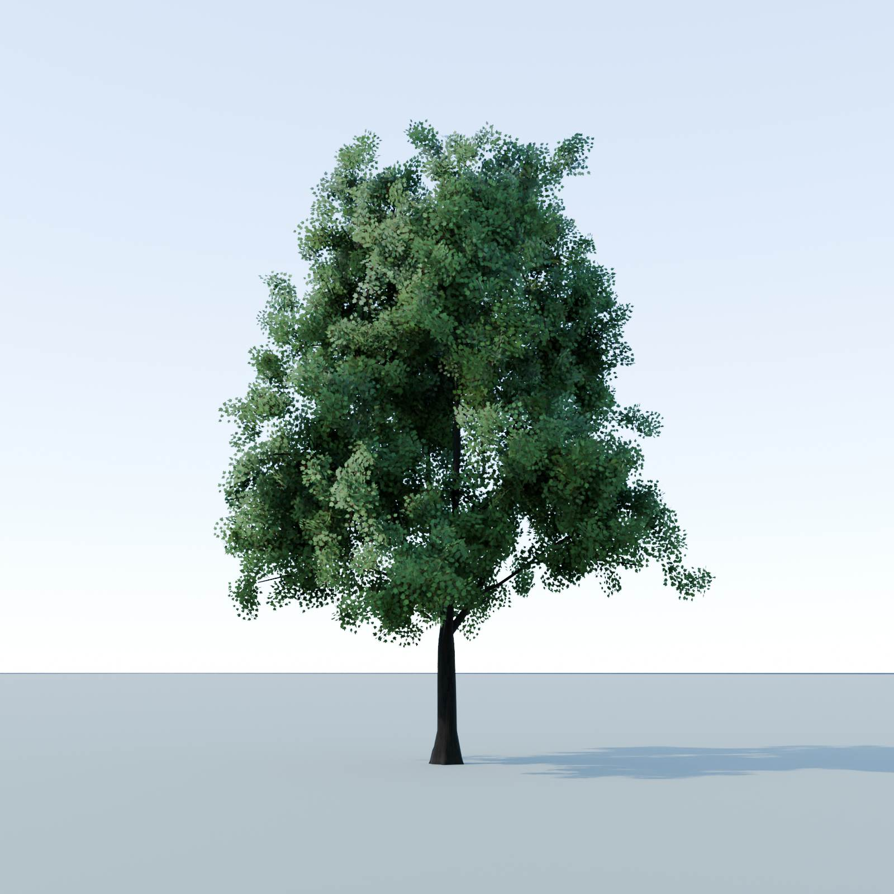
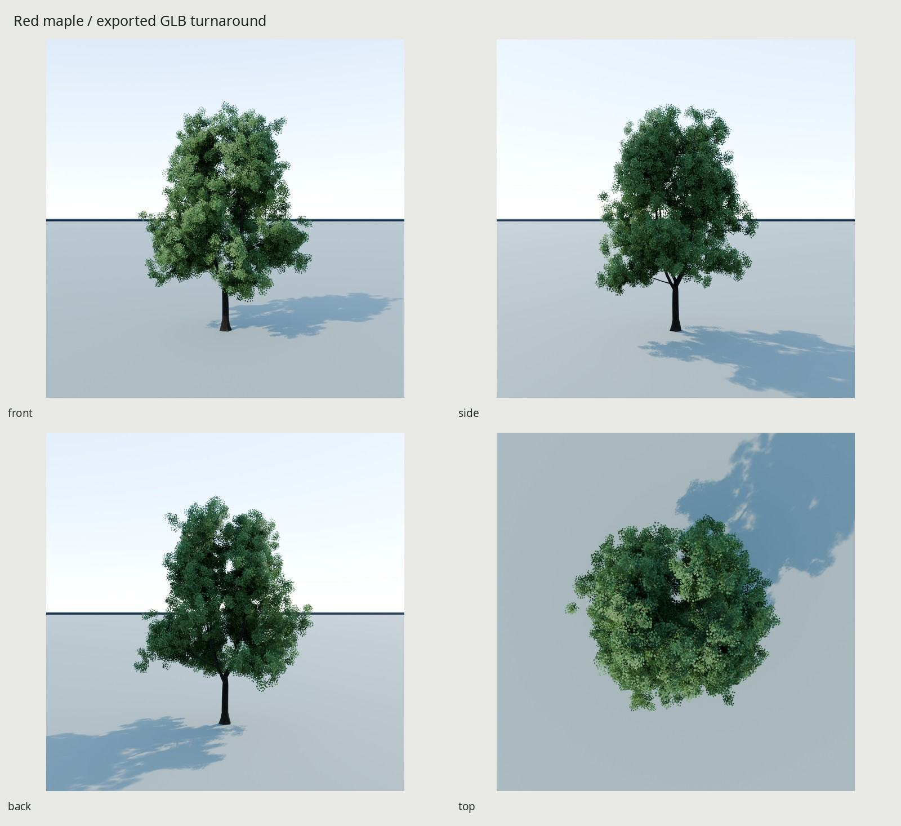
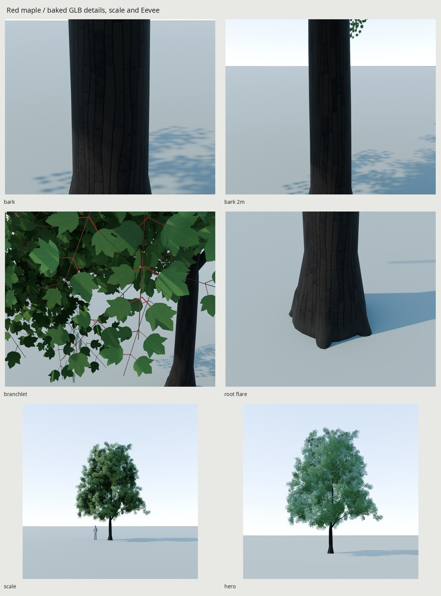
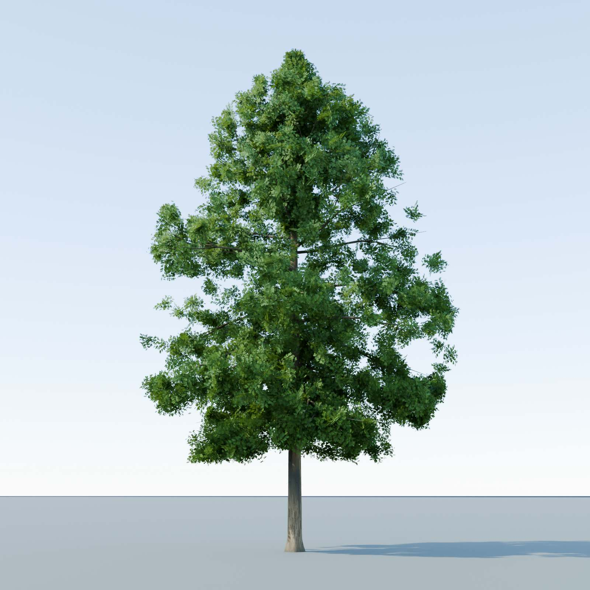
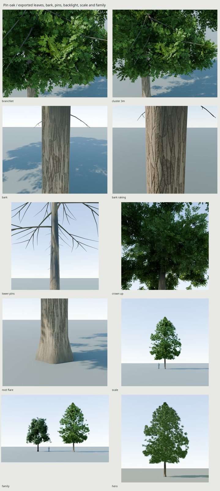

# Trees / red maple and pin oak

Two original scripted summer street trees: a spreading **red maple**
(*Acer rubrum*) and a taller, central-led **pin oak** (*Quercus palustris*).
Each has two materials, one shared-within-species 2048² alpha/PBR atlas and
linear Wind data in its GLB. Both use the same scripted botanical delivery
pipeline; the maple's accepted source data is preserved byte for byte.

| Species | Visible height / maximum crown width | Triangles | Estimated GPU memory |
| --- | --- | ---: | ---: |
| Red maple | 12.43 m / 9.80 m | 23,680 | 18.55 MiB |
| Pin oak | 16.75 m / 10.67 m | 24,816 | 18.77 MiB |

The dimensions below are measurements of generated surfaces. The authored ages
(about 20 / 25 years) are specimen briefs, not surveyed ages of the photographs.
See [oak delivery](#pin-oak--summer-delivery), [critique](REVIEW.md#pin-oak--bark-only-polish),
[oak species evidence](OAK_REFERENCE.md) and [reference credits](refs/SOURCES.md).

An original scripted summer **red maple (*Acer rubrum*)**, about 12.5 m tall,
with a 9.8 m crown and a 36 cm trunk. The specimen represents an open-grown
front-yard tree around twenty years old; age is an authored brief, not inferred
from a surveyed reference tree.







All presentation images use the **exported GLB and its embedded baked texture
set**. The foliage renderer implements the documented thin-leaf response from
those maps. Lighting is procedural daylight; no HDRI or reference pixels enter
the asset.

[Full contact](renders/final/contact.jpg) ·
[Penn State pair](renders/final/match_psu-measured-pair.jpg) ·
[Oregon State pair](renders/final/match_osu-measured-pair.jpg) ·
[Bark value crops](renders/final/bark-value-pair.jpg) ·
[Critique history](REVIEW.md) · [Species evidence](REFERENCE.md).
The full-resolution files are local rebuild outputs; the three docs JPGs are
tracked.

## Scale and construction

| Measured source surface | Result |
| --- | ---: |
| Complete mesh, including transparent card corners | 10.074 × 9.111 × 12.535 m |
| Retained foliage X / Y width | 9.801 / 8.857 m |
| Retained foliage base / top | 2.086 / 12.432 m |
| Fitted trunk diameter at 1.35 m | 0.361 m |
| Grade section, area-equivalent diameter at 0.01 m | 0.620 m; 1.72× DBH |
| Flare section at 0.70 m | 0.373 m; 1.03× DBH |
| Root reach below 8 cm height | 0.378 m |
| Conservative whole-card walking clearance within 1 m of bole | 2.826 m |
| Four co-dominant emergence heights | 2.193–2.726 m |

Meters; Blender +Z up and −Y front, glTF +Y up and +Z forward. Origin is at the
bole's footprint center on grade. Two static meshes, no armature or moving parts.
The scale silhouette is the toolkit's unchanged 1.8 m human.

Four curved co-dominants support 23 asymmetric scaffold masses, 69 secondary
limbs and 276 fine fourth-order forks. The last order continues in branchlet
cards. Overlapping leafy growth partly fills the deepest mass windows, broadens
the upper sides and preserves the low skirt. Branch load determines nominal
pipe radii; collars swell at attachments. The actual wood is one connected,
sealed triangulated surface. Opposing microscopic union slivers are removed
before acceptance rather than left for the exporter to discard.

Five broad buttresses merge into a smooth lower-bole flare and disappear into
grade. Section measurements use actual triangle/plane intersections; pipe
conservation checks concern authored profiles, not exact fused-surface areas.

## Budget and texture split

| Allocation | Delivered cost |
| --- | ---: |
| Wood | 8,080 triangles |
| Foliage | 15,600 triangles; 7,800 cards |
| Total / cap | **23,680 / 25,000 triangles** |
| Materials / static meshes | **2 / 2** |
| GLB, including embedded maps | **7,876,072 bytes** |
| Shared BaseColor-alpha / OpenGL +Y Normal / ORM | **2048² each**, from 4096² source/bake |

Delivered PNG sizes are 1,398,128 bytes BaseColor-alpha, 2,411,146 bytes Normal
and 1,388,801 bytes ORM. The GLB embeds those same images once.

Both materials share the same three images. The lower atlas half holds eight
repeated branchlet variants; the upper half holds unique bark islands. Bark is
GPU Cycles baked; the original analytic leaf albedo, alpha, cup/rib normals and
roughness are composited at 4096 before filtering. Photographs are never read
by either generator.

BC7 BaseColor-alpha, BC5 normal and 8-bpp ORM with full mip chains total about
**16 MiB** of texture memory. Vertex/index buffers add about **2.5 MiB**, for
about **18.55 MiB** total before engine overhead. The two extra bole UV seams
add 5,760 bytes of vertex data (0.0055 MiB) over the previous delivery; texture
allocation is unchanged. PNG/GLB storage and uncompressed runtime textures
have different sizes. The independent delivery report records
exact file and accessor sizes.

Unique bark UVs have no overlaps. Two bole seams isolate the eye-height band;
unwrap/packing uses the delivery region’s aspect, with roughly **460 px/m in
every tangent direction** there. Bark occupies about 23% of the whole atlas,
with half the atlas reserved separately for foliage. Leaf-card density is
727–812 px/m at 2048. Alpha reuse is intentional only inside the declared leaf region.

## Materials and engine integration

The branchlet variants carry 24–30 opposite leaves each. Blade length is
6.6–9.4 cm before 0.94–1.05 card scale variation: approximately **6.2–9.9 cm**
delivered. Broad shallow three-lobed outlines, occasional five-lobed blades,
serrated margins, palmate veins and small cup/tilt changes are generated
mathematically. Red petioles, red-brown current-year shoots, sparse insect bites
and a few older leaves provide species detail.

The leaf shader has no emission. It mixes 40% diffuse transmission with the
reflective leaf surface, gives below-view backs a desaturated gray-green
response and rejects glancing cards using their true geometric normal.
Lighting normals bend 90% toward a radial field blended **40% crown / 60%
branch mass**. Orthogonal companion cards maintain coverage from every view.
Bark has original seeded 2–4 cm longitudinal ridges divided into 10–30 cm
shallow plates. Independent wandering ridge edges, torn lips and fine granular
relief bake into the normal map; physical cavity visibility multiplies the
geometric ORM occlusion. Bark maturity follows both height and stem radius:
limbs below 10 cm diameter stay smooth and lighter. Rain tracks darken the
lower bole below the crotch; north-side lichen stays sparse. The matte response
uses exported KHR_materials_specular/ior constants, without another texture.
Honor those extensions, or port specularFactor .24 and IOR 1.45 into the engine
material; discarding them restores the excessive blue sky reflection.

The GLB supplies ordinary double-sided **MASK PBR** foliage. Stock glTF cannot
fully describe this thin-leaf/backface/glancing response. For the demonstrated
appearance, port `src/leaf_material.py` to the engine's foliage material: true
normal/view coverage fades over cosine 0.13–0.32, alpha cutoff 0.45. The final
renderer restores that response using **only the imported embedded maps**.
It loads no procedural bark or source geometry.

All source vertices carry floating-point RGBA `Wind`. Export preserves those
linear channels as the custom vertex-color attribute **`_WIND`**, avoiding the
standard `COLOR_0` albedo multiplier. The engine importer must retain it or copy
it into its wind-data vertex-color channel.

| Channel | Meaning |
| --- | --- |
| R | Height-based sway; wood up to .65, leaves up to 1; zero at grade |
| G | Branch hierarchy / 4; bole/roots 0, co .25, scaffold .5, secondary .75, leaf 1 |
| B | Seeded branch-family phase in [0,1] |
| A | Leaf flutter .65–1; wood 0 |

The engine adds the wind shader, instance variation, distance LODs and impostors
or billboards. Keep authored bent normals on foliage; automatic normal
recalculation loses the mass shading. Wind is not animation baked into the GLB.

## Rebuild and checks

```sh
make -C trees                  # refs → source → UV → bake → GLB → final renders/docs/checks
make -C trees check            # source, camera, bake, GLB/PBR/UV and botanical serialization checks
make -C trees tree-render PASS=study WIDTH=1200 SAMPLES=32
make -C trees tree-match PASS=study WIDTH=1200 SAMPLES=32
make -C trees tree-contact PASS=study
```

Requires installed Blender 5.2, Python/NumPy/Pillow, fontconfig/Noto Sans and
`flock`. Every Cycles bake/render uses the shared GPU lock. Defaults are 4096
bakes, 2048 delivery maps and 1600 px / 72-sample final renders. No downloaded
code, 3D assets, textures or lighting are needed.

Species and specimen controls now live in `src/maple.py` and `src/oak.py`.
`src/species.py` passes an explicit namespace through shared growth, sweeps,
wood unions/UVs, bark fields, leaf atlas, Wind and build code.
`src/settings.py` remains the backward-compatible maple import.
The maple uses its existing decurrent axes and exact random sequence; oak
selects `oak_growth.py`: a continuous leader, irregular primary attachments,
curved secondary forks and short card laterals. Atlas layout and delivery
policy are shared; oak-specific build outputs stay under `build/oak/`. `growth.py`, `wood.py`, `wood_uv.py` and `leaves.py` implement the
family algorithms. The common toolkit handles UV packing, baking, filtering,
export and independent GLB verification.

`build/structure-check.json` measures actual source form and topology.
`build/delivery-check.json` independently checks the GLB's geometry, dimensions,
PBR images, material/alpha state, UV overlap and density.
`build/botanical-delivery-check.json` compares actual positions, split normals
and linear wind values through raw accessors and fresh import. Final image
metadata records the GLB hash; `renders/final/render-check.json` rejects stale
or source-scene presentation images. These checks prove their stated scopes;
only the photo pairs and close-ups establish appearance.

## Final photo and build evidence

The bark correction rebuilt the source scenes, UVs, 4096 bake, filtered maps,
GLB and full presentation with `make -C trees`; `make -C trees check` passes.
Twenty-one Cycles views (19 presentation/diagnostic views plus two photo cameras) and one Eevee
hero all match the current GLB hash. The kit and botanical delivery checks
find zero position/Wind errors, split-normal vector difference below 8.6e-5,
zero UV overlaps and zero missed/black interior bake texels of 3,511,566 checked.
Six finishing critique passes, including the lead’s bark correction and
rejected candidates, are logged in REVIEW.

| Final comparison | Model | Photo |
| --- | ---: | ---: |
| Penn State crown W/H | .961 | 1.256 |
| Oregon State crown W/H | .952 | .960 |
| Penn State green display luminance p5 / median / p95 | .037 / .218 / .543 | .073 / .260 / .564 |
| Penn State brightest-fifth median | .488 | .495 |
| Penn State shaded-fifth hue | 123.2° | 124.9° |

The crown median is lower than the lime round-3 checkpoint (.244). Shaded
recesses remain darker than the photograph: 1.84% of selected green pixels fall
below .02 display luminance, versus .38% in the photo; none clip a channel.
Oregon State is judged for form only. These are display-image comparisons
across different lighting and individuals, not calibrated reflectance.

Bark display-value patches are measured in `bark-evidence.json`, with their
rectangles shown in the [bark comparison](renders/final/bark-value-pair.jpg).
Penn State lower bole is **.119 model / .124 photo** median display luminance;
upper shade is **.041 / .077**. The lower surface is now dark gray-brown rather
than pale blue-gray. The model’s shade remains darker and cooler than the photo.
Both photo patches sit beneath the crown; they are not equal-lighting albedo
calibrations. OSU slide values are recorded but are not a color target.

The shipped eye-height band measures **458–462 px/m by area**, and **457–464
px/m in every tangent direction**. Uniform surface-area samples from the
embedded maps find median / p90 tangent-normal deviations **4.27° / 14.75°**;
ORM occlusion p10 is **.608**. These verify retained normal/occlusion variation;
the bark and two-meter images establish whether it reads. Plate lips remain
flat at grazing angles, with some procedural regularity in macro views.

## Limits and credits

The crown is more compact and its masses more distinct than Penn State's broad
individual. Some isolated upper wood remains angular. Close branchlet views
expose flat-card construction and soften the smallest teeth/scars at this
texture budget. The bark retains a low-poly silhouette and cannot show
displaced plate edges at grazing angles.
The engine foliage shader and distance impostors remain integration work.

The Penn State photograph is the color/value reference; the Oregon State slide
is used for form only. Neither supplies surveyed dimensions or age. Camera
fits compare different individuals and retain their residuals. Reference
credits, URLs and rights are in [refs/SOURCES.md](refs/SOURCES.md); comparison
photographs stay local and are never committed in docs. Every asset vertex and
texel is generated by our scripts.


## Pin oak / summer delivery





[Contact](renders/oak-final/contact.jpg) · [Turnaround](renders/oak-final/turnaround.jpg) ·
[OSU pair](renders/oak-final/oak_match_osu-pair.jpg) ·
[Stony Brook pair](renders/oak-final/oak_match_stony-pair.jpg) ·
[Bark pair](renders/oak-final/bark-pair.jpg) ·
[1 m raking bark](renders/oak-final/bark_raking.png) ·
[3 m cluster](renders/oak-final/cluster_3m.png) ·
[Both exported species](renders/oak-final/family.png).
Every final imports the GLB and its embedded maps; the family imports both GLBs.
No procedural source bark or replacement geometry is used in final views.

| Actual surface measurement | Result |
| --- | ---: |
| Complete mesh, transparent corners included | 10.975 / 10.511 / 16.944 m |
| Retained-alpha crown X / Y width | 10.667 / 10.155 m |
| Retained foliage base / top | 2.570 / 16.752 m |
| Chest-height circle-fit trunk diameter | 0.4335 m |
| Grade flare / DBH | 1.418× |
| Conservative whole-card clearance within 1 m of bole | 2.581 m |
| Primary / secondary limbs / dead pins | **40 / 119 / 22** |
| Broadest mean section / crown-height fraction | 10.308 m / 30.8% |
| Mean-section width / crown height | **0.727** |

The 25-year age is the specimen brief, not a surveyed age inferred from a photo.
A single leader carries irregular slender primaries and 2–4 secondary forks each.
Lower primaries use ten sweep stations for continuous drooping arcs. Short leafy
laterals run along their inner portions and the lower secondaries; retained outer
sprays preserve the broad, ragged skirt. Small secondaries hidden inside foliage
use three axial stations, recovering **1,008 triangles** for **420 extra low
cards**. Those 420 cards are allocated only to low branches. Five shallow buttresses
remain continuous with the bole. Wood is one connected sealed surface. Origin
is at the trunk base on grade; no armature or moving parts.

| Delivery allocation | Cost |
| --- | ---: |
| Wood / alpha-card triangles | **10,536 / 14,280** |
| Total / cap | **24,816 / 25,000** |
| Branchlet cards / materials / static meshes | **7,140 / 2 / 2** |
| GLB, embedded textures included | **11,702,192 bytes** |
| BaseColor-alpha / OpenGL +Y Normal / ORM | **2048² each**, from 4096² bake/composite |
| Full-mip compressed textures / geometry | **16 MiB / 2,901,792 bytes** |
| Estimated combined GPU memory | **18.767 MiB**, before engine overhead |

PNG storage is **2,522,466 / 4,264,602 / 2,008,756 bytes**. Both materials
share these three images; the lower atlas half intentionally reuses eight leaf
variants. Each species has its own atlas. Bark priority is concentrated at
chest height: **648–650 px/m** in every tangent direction.
Unique wood UV coverage is **30.28% of the whole atlas**, with zero
overlap, degenerate or out-of-region triangles in the independent delivery check.

### Leaves, bark and engine response

The accepted eight branchlet variants retain 51–53 alternate leaves, 8.14–12.88 cm
including card scaling. Five/seven bristle-tipped lobes, deep rounded sinuses,
pinnate ribs and cup/twist normals are original analytic geometry/texels; no
photograph is traced or baked. Whole blades stay inside their tiles.

Upper cuticles keep a visible local sheen: specular .18, front roughness floor
.48; backs are paler and matte (.76). Thin-leaf transmission is .32 with a
yellow-green spectrum and no emission. Reduced shared normal bending (.42)
gives individual blades more independent lighting.
Local mass blend remains .48 low / .28 upper. Keep those custom normals and
port `src/leaf_material.py` into the engine; ordinary glTF MASK PBR approximates
this two-sided/glancing response. The GLB retains linear **_WIND**, using the
channel convention above. Wind, LODs and impostors remain engine integration.

Original warm gray-brown bark has flat interlacing ridges nominally 2–5 cm wide
and 10–40 cm long. Meter-scaled brown channels have finite floors and sloping
shoulders; the axial fissures split/rejoin and cross breaks stay shallower.
The authored 5.5 mm relief field, chipped shoulders, fine cork exfoliation,
sparse pale lichen and sheltered rain tracks bake into the existing maps. Relief is visible
in the exported [1 m raking view](renders/oak-final/bark_raking.png). Limbs retain
smoother bark. Matte wood constants specular .06 / IOR 1.45 survive in glTF
extensions; raw embedded albedo is measured independently of illumination.

Eevee's preview uses the same maps, sun and leaf shader. Its ambient hemisphere
is explicitly calibrated to Cycles: strength .18 versus .28, indirect spectrum
(1.22, 1, .70), approximating missing warm canopy/grade bounce. Its camera sees
the same procedural sky. This is a documented lighting approximation; Eevee's
interior shading remains flatter. Final foliage hue differs by
**0.0058 turns**, median Y by **+0.0011**,
and mean HSV value by **-0.0011**; each meets .05.

### Photo comparisons and bake loss

| Selected foliage display population | Export | Photograph |
| --- | ---: | ---: |
| OSU median foliage Y | 0.322 | 0.335 |
| OSU foliage above .5 | 26.29% | 25.81% |
| Stony Brook median foliage Y | 0.211 | 0.210 |
| Stony Brook foliage above .5 | 9.10% | 9.61% |
| OSU bright fifth Y | 0.659 | 0.649 |
| OSU shaded fifth Y | 0.124 | 0.119 |
| Stony Brook bright fifth Y | 0.489 | 0.494 |
| Stony Brook shaded fifth Y | 0.079 | 0.080 |

These use the same green-pixel mask as the earlier accepted fifths (G > 1.10 R,
G > 1.08 B); sky, wood, neutral glints and grade are excluded by that rule where
possible. They compare different specimens and photographic processing, not
calibrated reflectance. Medians and both fifths meet .03. The JSON also records
a looser-mask diagnostic; it can admit the scanned photo's tinted sky and is
not presented as segmented foliage. Per-view daylight is explicit and the
same authored albedo is used in both pairs. OSU sun/sky/exposure is 11/.25/1.05;
Stony Brook is 7.6/.22/.5. Both source pairs were repeated at
1600 px / 72 samples; maximum source/export fifth difference is **0.0008**.

The unchanged marked bark patch is measured in display Y:

| Bark population | Export | OSU photo |
| --- | ---: | ---: |
| Median | **.415** | .422 |
| Ridge tops: median of brightest third | **.507** | .518 |
| Fissures: median of darkest tenth | **.269** | .250 |
| Dark-channel proxy: pixels below Y .30 | **13.22%** | 11.43% |

All three new population errors are below .03; the median stays within .01 of
its previous .408. Median RGB is **(.412,.420,.369)** versus
**(.424,.427,.373)**: red exceeds blue in both. The same fixed dark cutoff is
used in both patches, rather than independently forcing each image to have a
10% dark population. It is a display-shadow proxy, including some other deep
bark shadow, not semantic segmentation or calibrated reflectance.
The measurement rectangles and per-channel evidence are recorded in
`renders/oak-final/color-value-evidence.json`. The pair now displays comparable
bole widths; its measurement rectangles are unchanged.

Uniform surface-area samples on the embedded chest-height maps give tangent-normal
median / p90 **8.97° / 41.48°** and occlusion p10 **.655**, versus the old
6.13° / 19.94° and .871. Directional density remains **648.35–650.32 px/m**.
These measure retained texture response, not displaced depth; the raking render
shows the practical relief while the geometry and silhouette remain exact.

The repeated source bark pair measures median / ridge / fissure **.407 / .504 /
.248**, versus shipped **.415 / .507 / .269**. Its fine dark proxy falls from
**18.06% to 13.22%** after baking/filtering; the shipped median rises .00756.
This is visible bake loss of fine cork, not a claim that the source and export
are pixel-identical. The new values are calibrated on the exported 2048 maps.

### Rebuild and proof

```sh
make -C trees SPECIES=oak             # source → UV → 4096 bake → 2048 GLB → finals/docs/checks
make -C trees SPECIES=oak check
make -C trees SPECIES=oak match PASS=oak-source-study WIDTH=1200 SAMPLES=40
make -C trees check                   # maple regression and delivery gates
```

`oak.mk` isolates species outputs. Shared kit tools still own finalization,
GPU baking, filtering, export, camera fitting and independent verification.
No kit file changed. All final Cycles work uses the inherited shared GPU lock.
The source/game geometry digest, actual construction, camera, raw GLB/fresh
import positions/normals/Wind, texture/bake coverage and repository checks pass.
`oak_final_review.py` gates ridge/fissure values and dark share within .03, the
retained median within .01, warm hue and actual 1 m camera distance. It also
verifies all **16 Cycles + 1 Eevee** source hashes and the
family's maple hash before replacing the two oak docs JPGs. The family keeps
five tracked JPGs total; photos and generated binaries remain local rebuild outputs.

Maple source arrays and all four original PNG inputs remain byte-identical.
All 12 delivered accessors match; re-exporting with preserved maps reproduces
the complete original GLB. The fresh GPU bake differs in **5 / 6 / 5 channels**
(BaseColor / Normal / ORM), each by one 8-bit step, consistent with the
unchanged-source GPU control. Reports are
`build/maple-source-comparison-revision.json` and `build/maple-byte-comparison-revision.json`.

Remaining CG tells: some outer tier spacing is more orderly than the photos;
very close views expose planar cards and soften bristles. Bark relief is normal
mapped, so grazing silhouette edges remain smooth, and its fine-scale richness
still falls short of the photograph. Some upper highlights remain too concentrated
(OSU upper-region bright share 34.44% versus 28.48%). Eevee has flatter interior shading. Detailed
color-first critique and rejected candidates are preserved in [REVIEW.md](REVIEW.md).


The bark-only polish keeps the original oak geometry, UVs, normals, tangents,
Wind, nodes/material constants and every leaf-region/alpha pixel exact.
`src/check_bark_preservation.py` compares a local pre-edit snapshot; its default
mode is read-only. An explicit `--restore-tangent-rounding` mode can retain our
original tangent bytes after all non-tangent/layout/image/maple comparisons
pass, rejecting changes beyond four components / .00011. Some look-dev candidates showed one component recalculated by .000099957;
that optional mode was verified without changing image payloads. The final
quieter export passes all twelve accessor buffers exactly in the default
read-only audit, without a restoration.
The snapshot and audit JSONs stay under ignored `build/bark-polish/`.

An isolated fresh maple source rebuild, finalize and preserved-map export also
reproduces the complete original GLB byte for byte (**7,876,084 bytes**,
SHA-256 `19cbc7bfc89abc87d664bf6744ec429ec9820a52a25f65e96fd8b1402d748438`).
Its source arrays, four packed PNG inputs and growth JSON are exact; its existing
source/delivery files and three docs JPGs remain untouched. Final preservation
proof is in `build/bark-polish/preservation-final.json` and
`maple-fresh-finalized-comparison.json` beside it. No kit changes.
