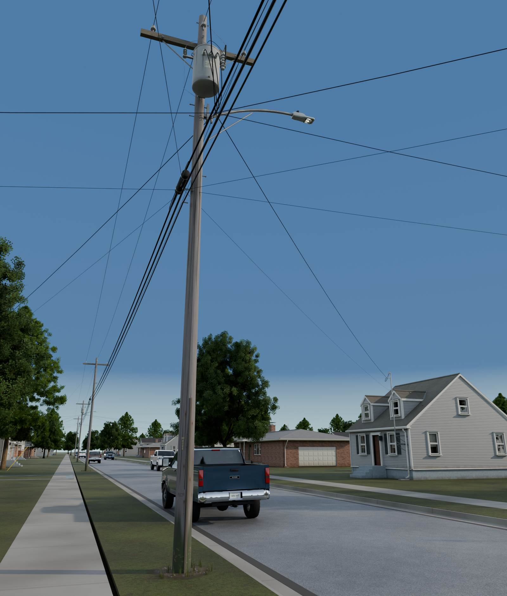
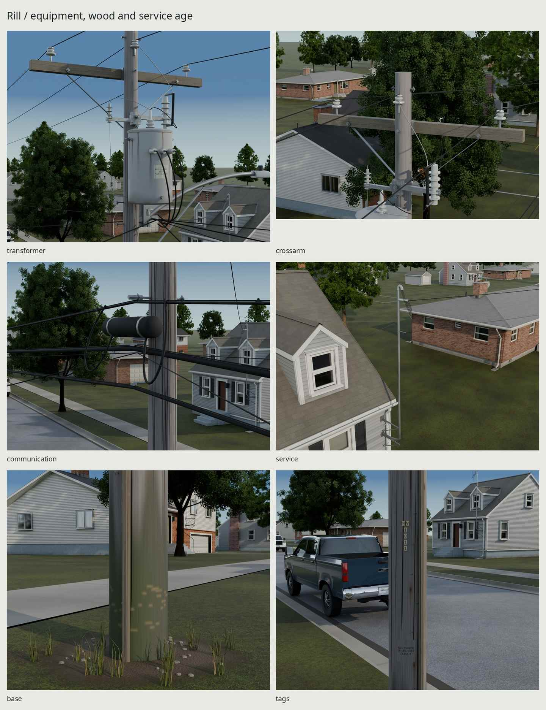
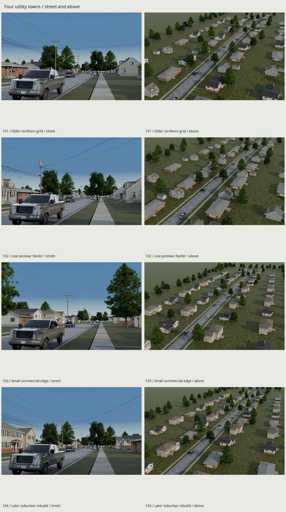
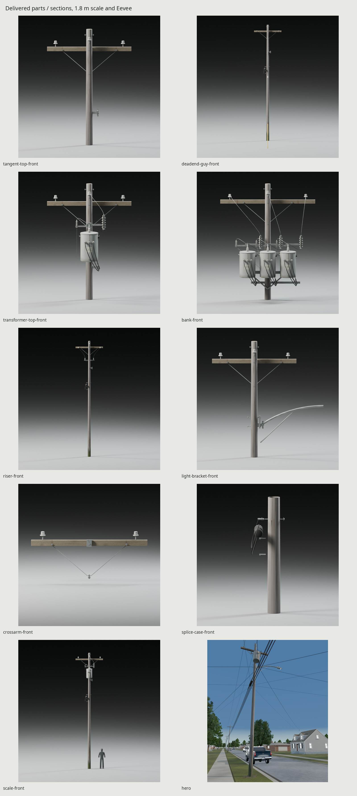
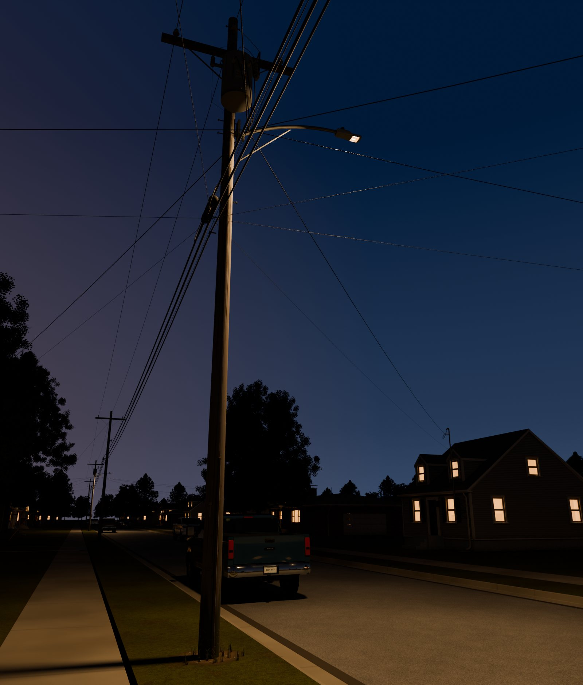

# Rill / wood utility poles and overhead lines

Original scripted US residential distribution, maintained 1970–2010 equipment
with 15–30 years of service age. Reusable pole assemblies and four streets
share one 2048 atlas through external-image glTF delivery.







The utility in every final is imported from its delivered glTF and baked maps.
After rebuilding, inspect [the complete 69-view contact sheet](renders/final/all-views.jpg),
[the street/detail contact sheet](renders/final/contact.jpg),
[gallery turnarounds](renders/final/gallery.jpg),
[matched-light pairs](renders/final/matched-pairs.jpg), and
[30/60/120 m wire controls beside photos](renders/wires/photo-distance-pairs.jpg).
[Native before/after crops](renders/fixes/comparison.json) retain at least
800 pixels per panel; the hero/dusk deliberately change composition.

[REFERENCE.md](REFERENCE.md) distinguishes published dimensions from authored
choices; [REVIEW.md](REVIEW.md) records the critique rounds and remaining
limits; [refs/SOURCES.md](refs/SOURCES.md) records authors, rights and URLs.

## Construction and scale

Southern yellow pine, **ANSI class 4**, linear taper and bare cut top. WPS
P25/P30 and the published ANSI O5.1-2008 table supply the dimensions.

| Overall / set depth | Exposed height | Circumference 6 ft from butt | Top circumference |
| --- | ---: | ---: | ---: |
| 35 / 6 ft | 8.8392 m | .8001 m / 31½ in | .5334 m / 21 in |
| 40 / 6 ft | 10.3632 m | .8509 m / 33½ in | Same |
| 45 / 6½ ft | 11.7348 m | .8890 m / 35 in | Same |

The exported polygon perimeters are measured, including the below-grade
reference station on the 45-ft pole. Only a 120 mm insertion stub is geometry.
Pole origins sit at grade at the shaft center. No climbing steps are supplied.

A fictional **12.47/7.2 kV grounded-wye** system uses WPS-informed crossarm
and armless framing. Arms are 2.4384/3.048 m long, .09525 × .12065 m in
section, with steel braces, bearing washers and ⅝-in through-bolts. Gray
ANSI 55-3 porcelain has a 120.65 mm shed and 95.25 mm body height; seeded
armless poles use polymer posts. The MPS-informed 50 kVA can has a 508 mm
tank and 1,066.8 mm bottom-to-HV-terminal height, rolled lip, lifting eyes,
hangers, grounded cutout/arrester equipment and separate leads.

The three-can pole has three primary phases and three independent 120/240 V
secondary circuits. Center A supplies the sample houses; B/C retain distinct
service sockets. This is a mechanical bank, without a three-phase secondary
interconnection diagram. Each riser phase has its own sealed termination.
Dead ends and angles carry 9.525 mm guys, 15.875 mm anchor rods and 2.4384 m
hollow yellow guards. The street-light bracket uses a 60.3 mm tube and 2 m
reach; its separate library head is presentation only.

## Wires and the four streets

| Conductor | True envelope | Source / construction |
| --- | ---: | --- |
| Primary | 10.1092 mm | Southwire Raven 1/0 6/1 ACSR |
| Neutral | 8.0264 mm | Southwire Sparrow #2 6/1 ACSR |
| Triplex hots / messenger | 7.6962 / 6.35 mm | Classic Wire #4 Periwinkle, triangular constituent packing |
| Telephone | 37 mm | Published 200-pair .63 mm GR-421 envelope |
| CATV | 24.384 mm | QR860 jacket, separate 6.35 mm strand |
| Fiber bundle | 2 × 15.8 mm, 31.6 mm wide | Two touching jackets, separate 6.35 mm strand |
| Retained copper | 28 mm | Published 100-pair .63 mm GR-421 envelope |

Three primary phases and one neutral, or one phase and neutral, remain as
accepted. Communication counts are independent supported routes: telephone,
CATV, optional paired fiber, optional older copper. The 680 × 144 mm splice
case has clamps and returning slack loops. The triplex mass correction to
.227692 kg/m preserves the accepted sag by scaling horizontal tension.
All tension examples are authored self-weight states, not stringing tables.
Telecom forces scale with load to retain the accepted .24 kg/m / 900 N
catenary shape: 6,641.25 / 1,612.5 / 1,350 / 4,256.25 N for phone / CATV /
paired fiber / retained copper. Different sag ratios had brought neighboring
routes into contact. An independent section audit now measures at least
.226 m free vertical space between actual exported route envelopes across
84 sampled planes per communication street.

| Seed | Town / framing | Nominal span | Communication routes | Utility triangles |
| --- | --- | ---: | ---: | ---: |
| 101 | Older grid, 40 ft, three-phase crossarm | 140 ft | 3 | 45,804 |
| 102 | Postwar feeder, 35 ft, one-phase armless | 110 ft | 2 | 37,628 |
| 103 | Commercial edge, 45 ft, three-phase crossarm/bank | 185 ft | 0 | 41,734 |
| 104 | Later suburb, 40 ft, three-phase armless, shallow jog | 160 ft | 4 | 48,116 |

Each street has five poles and twelve optional service-mast attachments.
Geometry budgets exclude presentation context. The library houses face both
sides; native roads, walks and curbs continue beyond frame. Mature red maple
and pin oak occupy yards and strips, with crowns near the line corridor.
Original library pickups have three source paint variants; original light
heads and house windows receive a dusk presentation state. All context is
staged under `utility/build/context/`, using the neighboring families' own
source shaders; only utilities are delivered here as baked external glTF.

The hero uses a measured 1.68 m eye above the sidewalk and 35 mm portrait,
about eight metres from the near pole, with raking sun. The base and upper
equipment share the frame. Dusk retains that camera, a directional blue-hour
gradient, powered heads/windows and the pavement pool.
No downloaded lighting or assets enter any output.

Displayed line contrast is `(sky Y′ − line Y′) / sky Y′`, median of
61 transverse profiles in undenoised 1600 × 800 Cycles controls, 50 mm lens.
These are actual exported tubes or the evaluated far recipe, with a separate
empty-sky control for each exact horizontal range. Full profiles, linear-light
contrast and integrated deficits are in `renders/wires/contrast.json`.

| Range | Primary tube / ribbon | Telephone tube / ribbon | CATV tube / ribbon |
| --- | ---: | ---: | ---: |
| 30 m | 33.2 / 37.7% | 87.8 / 99.4% | 79.6 / 90.3% |
| 60 m | 10.5 / 15.5% | 51.1 / 53.8% | 34.1 / 34.7% |
| 120 m | 3.8 / 7.6% | 21.3 / 23.9% | 14.9 / 20.5% |

The photographs have **no surveyed line depths**. Their native near / middle /
far bare-line samples measure NC **11.0 / 9.7 / 6.8%**, Maryland
**23.1 / 23.6 / 24.7%**; separate jacket samples measure Maryland **60.1%**
and the hardware photo **83.7%**. The latter's profile follows the cable centre,
clear of the splice case; the earlier off-centre selection was rejected.
These bracket photographic visibility; they do not establish a literal
30/60/120 m photographic survey. Sky, lens, resolution and wire orientation
also differ. The 120 m primary still needs the documented engine policy:
physical tubes alone are insufficient for that view. The far policy restores
approximately the NC far sample's displayed contrast while retaining true
socket diameters and physical near geometry.

## Surfaces and delivery cost

One **2048² BaseColor / OpenGL +Y Normal / ORM** set, baked at 4096.
Sixteen guarded stock charts intentionally reuse UVs across parts. Two pine
charts carry silvered gray-brown grain, longitudinal checks, uneven wet/green
ground-line absorption, darker cut ends, bolt runoff and sign-removal scars.
Fir grain follows the arm; coherent waviness and knots avoid ruled grooves.
Paint chalks on exposure, with runoff starting at lift-eye welds/lid seam and
staining retained at the bottom. Zinc ages at cut edges and seats; dielectric
sheds retain lower-lip dust. Guard yellow fades on exposure and scuffs near
grade. Fictional RILL/RV marks share the atlas and conform to the real facets.
`WEAR=1` is the service-age default; it is a causal-mask strength, not a
uniform overlay. Old staples, nails, their runoff and removed-sign scars remain. The sparse
vine was removed; no leaf geometry or extra material is shipped. Ground
backfill, rounded gravel, unmown grass, worn lawn edges, leaf litter,
concrete variation and the photographic T corner are presentation only.

Balanced photo / exported-render appearances, median encoded RGB (0–255):

| Surface / light | Balanced photo | Export render | Render minus photo Y′ |
| --- | --- | --- | ---: |
| Shaded MD shaft | 96 / 98 / 105 | 100 / 106 / 113 | +.0265 |
| Sunlit VT / upper shaft | 149 / 142 / 132 | 149 / 144 / 139 | +.0081 |
| MD tank | 110 / 118 / 130 | 111 / 123 / 130 | +.0142 |
| MD upper sky | 196 / 206 / 229 | 198 / 206 / 228 | +.0020 |
| NC / clear hero upper sky | 79 / 124 / 167 | 79 / 124 / 167 | +.0007 |
| NC thin-cloud / hero lower visible sky | 184 / 198 / 200 | 167 / 185 / 191 | −.0520 |

NC/MD balance uses approximate achromatic clouds; VT uses sunlit white paint.
These are display appearances under estimated light, not calibrated albedos.
The sky patches occupy upper/lower image zones, not surveyed elevation angles;
the lower clear hero remains darker than the photographed thin-cloud patch.
[Measurements and neutral/patch rectangles](build/color-review/measurements.json)
retain that residual and the intermediate sky sample. The T corner's
[eight curb/walk joins](build/nc-corner-joins.json) are measured on actual
built mesh-edge endpoints, separately from photographic camera fitting.

| Material / parts | Maps | Why retained / draw calls |
| --- | --- | --- |
| `Utility`: pole, arm, transformer, mounting hardware, guy/guard/anchor, case, labels, optional mast | Shared trio | One PBR material and one primitive per fixed assembly; material variation is in the atlas |
| `Utility_Aluminum`: primary, neutral, messengers | None | Oxidized bare conductor response differs from jacket; one primitive per merged conductor group |
| `Utility_Cable`: telecom, service hots, drops | None | Near-black PE/XLPE needs its own rough dielectric response; one primitive per merged group |

The parts library has one material and nine primitives. Blocks have three
materials and **27 / 27 / 24 / 27 primitives**, including twelve optional
masts; the mixed service and telecom groups each have two primitives. There
is no armature or moving mechanism. Fixed parts can be instanced or batched
by an engine; these counts describe ordinary imported glTF draws.

| Reusable module | Triangles | Buffer bytes | Geometry memory | Materials / draws |
| --- | ---: | ---: | ---: | ---: |
| Tangent / angle | 3,632 each | 274,992 / 274,704 | 0.262 / 0.262 MiB | 1 / 1 |
| Dead end | 3,056 | 223,296 | 0.213 MiB | 1 / 1 |
| Transformer pole | 6,668 | 496,152 | 0.473 MiB | 1 / 1 |
| Three-phase riser | 4,356 | 319,320 | 0.305 MiB | 1 / 1 |
| Street-light bracket pole, excluding head | 4,024 | 301,344 | 0.287 MiB | 1 / 1 |
| Crossarm module | 1,248 | 103,872 | 0.099 MiB | 1 / 1 |
| Standalone transformer module | 3,036 | 221,160 | 0.211 MiB | 1 / 1 |
| Guy / guard / anchor | 280 | 20,592 | 0.020 MiB | 1 / 1 |
| Optional service mast | 1,088 | 70,656 | 0.067 MiB | 1 / 1 |
| Placed three-can pole, seed 103 | 8,438 | 690,036 | 0.658 MiB | 1 / 1 |

Per-part BIN bytes sum the actual buffer views referenced by each mesh,
including indices and vertex attributes. Shared maps, socket metadata and
scene JSON are counted separately below. The optional mast is a named part
of each street package; the bank is seed 103's `P3` assembly.

Optional light/communication combinations differ: seed 101's fullest
single-can pole is 7,060; the four-route armless seed 104 reaches 7,316.
The latter spends 256 more triangles on the requested extra communication
plant. The fullest riser is 4,356, below its accepted 4,528. All blocks remain
below 49k, funded by tighter catenary stations and repeated mast sampling,
with the same 8 mm/4 m curve screens. Individual tubes use 24–120 triangles
in these layouts; `build/checks.json` records every span.

External delivery is `export/UtilityParts.gltf` plus four
`export/UtilityStreet-<seed>.gltf`, their `.bin` geometry and `.json` sockets.
Every file points to the same `export/textures/` trio; images are losslessly
retained from the bake. Loading all five actually creates three image
datablocks, not five independent sets. Internal `build/*.glb` checkpoints
remain available for exact serialization checks.

| Package | glTF + BIN bytes | Geometry memory | Optional socket/curve JSON bytes |
| --- | ---: | ---: | ---: |
| `UtilityParts.gltf` | 2,268,943 | 2.132 MiB | 19,214 |
| `UtilityStreet-101.gltf` | 2,905,687 | 2.718 MiB | 211,643 |
| `UtilityStreet-102.gltf` | 2,412,537 | 2.254 MiB | 153,086 |
| `UtilityStreet-103.gltf` | 2,780,181 | 2.608 MiB | 145,517 |
| `UtilityStreet-104.gltf` | 3,004,135 | 2.812 MiB | 240,916 |

The shared PNGs total **10,052,350 bytes** (Normal 5,194,503, ORM 1,248,177, BaseColor 3,609,670). Count them once per family.
All glTF/BIN packages total **13,371,483 bytes**; optional sidecars add 770,376 bytes.

Geometry memory is the serialized vertex/index allocation; an engine may
repack these attributes/indices. Add the family-wide 16 MiB atlas once.
[The full measured cost report](build/costs.json) lists every part,
block instance and conductor group.

The three maps cost **16 MiB** with three 8-bpp block-compressed maps and
full mip chains, shared across all instances/seeds. This is an engine memory
estimate, not PNG disk size; uncompressed RGBA8 with mips is about 64 MiB.
The tall shaft and readable near-ground marks justify 2048; the chart audit
reports an area-weighted shaft density near 346 px/m, with greater allocation
for small markings and hardware. Reused UVs are intentional and tested as
guarded stock charts, not falsely reported as a unique nonoverlapping unwrap.

## Sockets, parts and game use

Meters, Blender +Z up, street run +Y, asset front −Y; glTF maps `(x,y,z)` to
`(x,z,-y)`. The parts library is `export/UtilityParts.gltf`; replace a part root's
inspection-layout transform. Pole grade remains local zero. Crossarm origins
are their central mounting-bolt datum; transformer origins are the pole-line
mount frame at tank-bottom height; guy origins use the pole grade datum.
Those mounted modules intentionally use installation frames rather than
standalone ground-prop centers.

Every pole carries `<root>__Socket_<name>` empties with `socket_kind`:

| Socket | Role |
| --- | --- |
| `Primary_A`, optional `Primary_B/C` | Actual tangent saddles or deadend clamps |
| `Neutral` | Neutral spool's outside bearing line |
| `Service` | Central triplex strain clamp; optional bank `Service_A/B/C` are distinct circuits |
| `CommStrand`, `LashedFiber_0/1`, `Telephone`, `CATV`, optional `LegacyCopper`, `<route>Strand`, `CommDrop` | Each long conductor and the house drop |
| `GuyUpper` | Upper guy eye |
| `CrossarmMount`, `TransformerMount` | Installation frames for reusable equipment |
| `Riser_Primary_A/B/C`, `RiserUnderground` | Sealed phase terminations and underground entry |
| `LightBracket`, optional `LightHead` | Bracket pad and head slipfitter; local −Y points toward the street after a +90° Z rotation |

`export/UtilityStreet-<seed>.json` records complete Blender world coordinates and
construction parameters. House mast roots carry `ServiceDrop` and
`CommunicationDrop`. `build/house-attachments-<seed>.json` is the optional
sidecar: local coordinates, instance transform, house type/seed and ray-measured
roof-guy anchor points. The mast's lower elbow enters the wall; an internal
route to the original meter is reserved, not modeled in the exterior shell.
No second meter, altered house mesh, house export or changed house script.
The render-context check also ray-tests the anchors against the actual posed
library house meshes, catching presentation rotations as well as modeling
errors. It does not substitute an intended transform for the visible geometry.

The pure-Python API works without Blender; add `utility/src` to the import path.
It uses +Z up. Convert imported engine coordinates `(x,y,z)` to `(x,-z,y)`
before calling it, then convert the result back with `(x,z,-y)`:

```python
from span import sample, sag_from_tension

# Transform imported socket positions into one common world frame first.
points, report = sample(start_socket, end_socket, sag=0.8)
# Or calculate a self-weight case from horizontal tension:
sag = sag_from_tension(start_socket, end_socket,
                       mass_kg_m=0.2158, horizontal_tension_n=550)
```

`sample` handles unequal supports, solves the actual catenary, and adaptively
subdivides to 8 mm chord error / 4 m maximum steps. Its arc length and minimum
height are included in the report. `construction.conductor` creates the Blender
tube. For an engine, sweep a four/six-sided section along the points, or use
`ribbon.data(points, diameter)` for the far mesh. Sag is below the chord at
horizontal midspan; it is not the absolute elevation of the lowest point.

At distance use the original `src/wire.gdshader` and `ribbon.data`: a camera-facing
.85-pixel floor, opacity `(true_width / widened_width)^.55`. Exponent 1.0
is strict integrated coverage; the calibrated .55 default retains more optical
contrast. Neither changes a socket's true diameter. Transition from physical
tubes below about .8 px projected width, retain tube shadows, apply object
scale, convert positions/tangents, and expand the runtime AABB. Cross-fade
without drawing both at full opacity. Use two shared far-material instances:
linear bare RGB (.012,.013,.012), jacket (.0015,.0017,.0015). The example
uniform deliberately takes linear vectors without `source_color`; the
[Godot color-uniform documentation](https://docs.godotengine.org/en/stable/tutorials/shaders/shader_reference/shading_language.html#using-source-color)
explains the sRGB conversion applied by that hint. The numeric inputs match
the Cycles inspection; an engine tone mapper will still alter displayed
contrast. This requires no texture. Godot
compilation, moving-camera AA and performance remain untested; the Cycles
inspection is evidence of the policy, not proof of an engine integration.

## Rebuild and evidence

```sh
make -C utility clean
make -C utility
make -C utility check
make -C utility repeat
python3 kit/repo_check.py
```

Installed Blender 5.2, Python/NumPy/Pillow and open fonts; one Blender process
at a time, four CPU threads, and the shared GPU lock for Cycles. Nothing is
installed or downloaded as code. Reference cache remains through `clean`. Native before/after rebuilding needs
Git history containing `f824685`; absent the inspected cache, its original
scripts are staged in utility-local scratch and rebuilt.
`make` rebuilds original fields, the Cycles bake, parts/blocks, external
delivery, physical/serialization checks, 22 Cycles street/detail views, 32 gallery turnarounds plus scale, three matched-light
pairs, exact wire-range controls, Eevee hero and native before/after crops. `make docs` writes the five
size-limited README JPGs after the full-size audit; no GIF is supplied.

`build/checks.json` measures actual shaft sections, planting-strip footprints,
wire surfaces, clipped road minima, interspace gaps, actual inter-route
triangle sections and roof overflight rays.
`build/delivery-check.json` separately proves external payload equality, UV
chart allocation/density, normal/tangent validity, conforming label contact,
socket re-import and three-image cache reuse. `build/repeat-check.json` records
a fresh geometry export, all original fields, and independent GPU rebake.
`make repeat` rebuilds all five geometry packages, all 48 original fields,
and an independent GPU bake without replacing canonical delivery maps.
Geometry and fields must repeat byte for byte. Bake tolerance is at most
2/255 per channel and .02/255 RMSE to allow GPU floating-point variation.
The Eevee checkpoint losslessly packs six house-context scalar masks into
two RGBA attributes and prunes unreachable shader branches to avoid its
vertex-attribute limit. Measured packing roundtrip error is zero; no utility
material or neighboring source is changed. Seven independent span controls pass. These checks establish construction
and serialization; only the full-size
images and photographic comparisons assess appearance.

Minimum supply/communication gap is about 1.228 m. The lowest private service
surface is 5.193 m; comm drop is 4.397 m. Actual road-clipped minima exceed
the selected 18-ft service / 15½-ft comm screens. Current layouts avoid roof
overflights. These are level-terrain authored tension cases, without
structural, ice/wind or all-weather certification.

No kit or neighboring family source/delivery is changed. Existing neighboring
generated deliveries were absent on takeover, so the recorded preservation
snapshot has zero files; no neighboring output path is written. The top-level
README stays with the lead. Photo dates after 2010 describe older maintained
plant and are not asserted as installation-period evidence.

The three photographic camera fits have RMS residuals of **6.51 / 6.19 /
9.74 px** (NC street / Maryland top / full communications portrait). The
held-out telephone-height shaft centre is **2.17 px** from the observed
point. The portrait is native 749 × 1640; both review crops are 570 × 370.
Upper-arm and shaft controls do not assert an exact can/case/span-layout fit.

Remaining limitations: photographed equipment mounts and passing-line azimuths
differ from the selected utility construction. The NC context is an original
curved approach/T corner, not a survey or a copy of its houses. Gallery top
and communication studies select unchanged exported triangles in documented
height windows; full poles remain available in the street packages. Fine
wood fibres are soft at shared-atlas macro density; long checks, dampness
and fastener stains carry age at pedestrian distance. The context still
repeats house, tree and pickup forms; NC paving/turf remain more even and
lighter than the photographic comparator. Four-sided wires retain a directional
width compromise, and the supplied far shader still needs an engine
compilation/motion-AA check. Helical triplex and long-span lashing remain
below the mesh budget. Dusk bare-wire specular samples can remain noisy.

## Credits

Dimensions and photographs: the published utilities/manufacturers and authors
in [refs/SOURCES.md](refs/SOURCES.md). Photos are local measurements/comparisons;
no photographed pixels enter geometry, shaders, maps, decals or committed docs.
Procedural sun/sky and all meshes/texels are original scripts. Fictional RILL
TIMBER, RILL ELECTRIC and RV IDs use installed DejaVu Sans, resolved through
`kit/fonts.py` (open Bitstream Vera/DejaVu license). Neighboring family scripts
supply presentation context without changing their source or delivery paths.

The other utility kinds have no additional chain yet; they await their own
geometry, support and switch-distance checks. See [the LOD review](REVIEW.md).

The 1,248-triangle crossarm stays at LOD0: its safe far trial saves only 76
triangles while allocating another nearly full mesh. See [REVIEW.md](REVIEW.md).

The standalone 3,036-triangle transformer stays at LOD0: its safe far trial
saves only 212 triangles. See [REVIEW.md](REVIEW.md).

Street wires and the 280-triangle guy/guard stay at their coarse LOD0 geometry.
The strict wire trial saves no triangles. See [REVIEW.md](REVIEW.md).

<!-- LOD checkpoint tangent: begin -->
## Tangent pole LODs

`make lod` builds additional core glTF/BIN files and a manifest under `export/lod/tangent/`; `make check-lod` checks them. The existing delivery is immutable LOD0. Default `make` and `make check` retain their original build graph.

| Level | Triangles / target | Materials / draw calls | Geometry bytes | PNG bytes | Total load bytes | GPU unique textures + mesh, MiB | Switch height / distance |
| --- | ---: | ---: | ---: | ---: | ---: | ---: | --- |
| LOD0 | 3,632 / — | 1 / 1 | 2,268,943 | 10,052,349 | 12,321,292 | 16.000 + 2.1319 | near |
| LOD1 | 2,852 / 1,453 | 1 / 1 | 261,001 | 10,052,349 | 10,313,350 | 16.000 + 0.2243 | 25.0% / 36.31 m |

Chain check: True; image check: True; normal check: True.


Whole-chain resident GPU estimate: **18.356 MiB**, versus LOD0 alone **18.132 MiB**. Unique textures 16.000 MiB = 16.000 MiB original + 0.000 MiB proxy/impostor; all meshes 2.3562 MiB. Increase over LOD0 0.224 MiB = 0.000 MiB far maps + 0.2243 MiB additional mesh buffers. Intermediate new images: 0. Bind intermediate primitives to the canonical LOD0 material resources; the manifest records full image hashes and source image indices. Identical embedded/external PNG bytes require this resource binding to share GPU allocations, including duplicate original image entries. GPU columns deduplicate complete image hashes within each row; PNG/dependency bytes retain physical payload copies. Optional camera-facing impostor is a separate alternative; engine overhead is excluded.

Distances are to the bound center at 60° vertical FOV / 1080p. GPU figures estimate 8-bpp block-compressed textures with full mips plus raw accessor mesh bytes, before engine overhead. Per-level map bytes describe dependencies, including reused originals. The whole-chain estimate deduplicates canonical image resources. Targets and achieved counts are reported separately; a count alone does not establish visual acceptance.

Load these files as alternatives and configure Godot visibility ranges, Unity LODGroup renderers, or Unreal mesh/component LODs. Keep matching near pivots in the same pose during switching. [Engine sources, pixel thresholds and texture policy](../kit/LOD.md).

Near levels consolidate static parts by material and simplify moving parts while retaining names, pivots, sockets and animation data. Intermediate levels preserve original charts, attributes and LOD0 materials. Only the proxy receives new charts baked from the immutable delivered maps and shaders. Intermediate levels allocate no additional images.

Native-pixel LOD0/adjacent strips, amplified differences, close views and measured image status: `renders/lod/tangent/` (`contact.jpg`, `metrics.json`). Raw checks: `export/lod/tangent/check.json` and `export/lod/tangent/normals-vs-lod0.json`; per-level construction/pruning decisions: `build/lod-uv/archive/utility/tangent-final/simplification.json` and manifest assembly receipts. [Critique, target misses and known failures](../kit/LOD_REVIEW.md).

Shipped PNG dimensions: LOD0: 3 × 2048×2048; LOD1: 3 × 2048×2048.

Selected placement roots: `Tangent`. LOD0 triangles, materials and draws describe those modules; its load bytes, maps and mesh allocation describe the complete unchanged original container. Extraction savings are separate from reduction. Retain child transforms when replacing a selected root placement.

Whole default chain:

| Stored mesh triangles | Material resources | Stored primitive placements | Distinct payload bytes | Resident GPU, MiB |
| ---: | ---: | ---: | ---: | ---: |
| 32,784 | 1 | 10 | 12,582,293 | 18.3562 |

Stored counts include the full immutable source container once and every default level; optional impostor alternatives are excluded. Near materials use their canonical source bindings. Physical payload files are counted once by path. Only one level is drawn per instance: active draw calls range from 1 to 1 across these kinds/levels. Stored primitive placements are not simultaneous runtime draw calls.

<!-- LOD checkpoint tangent: end -->

<!-- LOD checkpoint transformer-pole: begin -->
## Transformer pole LODs

`make lod` builds additional core glTF/BIN files and a manifest under `export/lod/transformer-pole/`; `make check-lod` checks them. The existing delivery is immutable LOD0. Default `make` and `make check` retain their original build graph.

| Level | Triangles / target | Materials / draw calls | Geometry bytes | PNG bytes | Total load bytes | GPU unique textures + mesh, MiB | Switch height / distance |
| --- | ---: | ---: | ---: | ---: | ---: | ---: | --- |
| LOD0 | 6,668 / — | 1 / 1 | 2,268,943 | 10,052,349 | 12,321,292 | 16.000 + 2.1319 | near |
| LOD1 | 5,604 / 2,667 | 1 / 1 | 473,660 | 10,052,349 | 10,526,009 | 16.000 + 0.4271 | 25.0% / 36.31 m |

Chain check: True; image check: True; normal check: True.


Whole-chain resident GPU estimate: **18.559 MiB**, versus LOD0 alone **18.132 MiB**. Unique textures 16.000 MiB = 16.000 MiB original + 0.000 MiB proxy/impostor; all meshes 2.5589 MiB. Increase over LOD0 0.427 MiB = 0.000 MiB far maps + 0.4271 MiB additional mesh buffers. Intermediate new images: 0. Bind intermediate primitives to the canonical LOD0 material resources; the manifest records full image hashes and source image indices. Identical embedded/external PNG bytes require this resource binding to share GPU allocations, including duplicate original image entries. GPU columns deduplicate complete image hashes within each row; PNG/dependency bytes retain physical payload copies. Optional camera-facing impostor is a separate alternative; engine overhead is excluded.

Distances are to the bound center at 60° vertical FOV / 1080p. GPU figures estimate 8-bpp block-compressed textures with full mips plus raw accessor mesh bytes, before engine overhead. Per-level map bytes describe dependencies, including reused originals. The whole-chain estimate deduplicates canonical image resources. Targets and achieved counts are reported separately; a count alone does not establish visual acceptance.

Load these files as alternatives and configure Godot visibility ranges, Unity LODGroup renderers, or Unreal mesh/component LODs. Keep matching near pivots in the same pose during switching. [Engine sources, pixel thresholds and texture policy](../kit/LOD.md).

Near levels consolidate static parts by material and simplify moving parts while retaining names, pivots, sockets and animation data. Intermediate levels preserve original charts, attributes and LOD0 materials. Only the proxy receives new charts baked from the immutable delivered maps and shaders. Intermediate levels allocate no additional images.

Native-pixel LOD0/adjacent strips, amplified differences, close views and measured image status: `renders/lod/transformer-pole/` (`contact.jpg`, `metrics.json`). Raw checks: `export/lod/transformer-pole/check.json` and `export/lod/transformer-pole/normals-vs-lod0.json`; per-level construction/pruning decisions: `build/lod-uv/archive/utility/transformer-pole-final/simplification.json` and manifest assembly receipts. [Critique, target misses and known failures](../kit/LOD_REVIEW.md).

Shipped PNG dimensions: LOD0: 3 × 2048×2048; LOD1: 3 × 2048×2048.

Selected placement roots: `Transformer`. LOD0 triangles, materials and draws describe those modules; its load bytes, maps and mesh allocation describe the complete unchanged original container. Extraction savings are separate from reduction. Retain child transforms when replacing a selected root placement.

Whole default chain:

| Stored mesh triangles | Material resources | Stored primitive placements | Distinct payload bytes | Resident GPU, MiB |
| ---: | ---: | ---: | ---: | ---: |
| 35,536 | 1 | 10 | 12,794,952 | 18.5590 |

Stored counts include the full immutable source container once and every default level; optional impostor alternatives are excluded. Near materials use their canonical source bindings. Physical payload files are counted once by path. Only one level is drawn per instance: active draw calls range from 1 to 1 across these kinds/levels. Stored primitive placements are not simultaneous runtime draw calls.

<!-- LOD checkpoint transformer-pole: end -->

<!-- LOD checkpoint angle: begin -->
## Angle pole LODs

`make lod` builds additional core glTF/BIN files and a manifest under `export/lod/angle/`; `make check-lod` checks them. The existing delivery is immutable LOD0. Default `make` and `make check` retain their original build graph.

| Level | Triangles / target | Materials / draw calls | Geometry bytes | PNG bytes | Total load bytes | GPU unique textures + mesh, MiB | Switch height / distance |
| --- | ---: | ---: | ---: | ---: | ---: | ---: | --- |
| LOD0 | 3,632 / — | 1 / 1 | 2,268,943 | 10,052,349 | 12,321,292 | 16.000 + 2.1319 | near |
| LOD1 | 2,834 / 1,453 | 1 / 1 | 260,164 | 10,052,349 | 10,312,513 | 16.000 + 0.2235 | 25.0% / 36.31 m |

Chain check: True; image check: True; normal check: True.


Whole-chain resident GPU estimate: **18.355 MiB**, versus LOD0 alone **18.132 MiB**. Unique textures 16.000 MiB = 16.000 MiB original + 0.000 MiB proxy/impostor; all meshes 2.3554 MiB. Increase over LOD0 0.223 MiB = 0.000 MiB far maps + 0.2235 MiB additional mesh buffers. Intermediate new images: 0. Bind intermediate primitives to the canonical LOD0 material resources; the manifest records full image hashes and source image indices. Identical embedded/external PNG bytes require this resource binding to share GPU allocations, including duplicate original image entries. GPU columns deduplicate complete image hashes within each row; PNG/dependency bytes retain physical payload copies. Optional camera-facing impostor is a separate alternative; engine overhead is excluded.

Distances are to the bound center at 60° vertical FOV / 1080p. GPU figures estimate 8-bpp block-compressed textures with full mips plus raw accessor mesh bytes, before engine overhead. Per-level map bytes describe dependencies, including reused originals. The whole-chain estimate deduplicates canonical image resources. Targets and achieved counts are reported separately; a count alone does not establish visual acceptance.

Load these files as alternatives and configure Godot visibility ranges, Unity LODGroup renderers, or Unreal mesh/component LODs. Keep matching near pivots in the same pose during switching. [Engine sources, pixel thresholds and texture policy](../kit/LOD.md).

Near levels consolidate static parts by material and simplify moving parts while retaining names, pivots, sockets and animation data. Intermediate levels preserve original charts, attributes and LOD0 materials. Only the proxy receives new charts baked from the immutable delivered maps and shaders. Intermediate levels allocate no additional images.

Native-pixel LOD0/adjacent strips, amplified differences, close views and measured image status: `renders/lod/angle/` (`contact.jpg`, `metrics.json`). Raw checks: `export/lod/angle/check.json` and `export/lod/angle/normals-vs-lod0.json`; per-level construction/pruning decisions: `build/lod-uv/archive/utility/angle-final/simplification.json` and manifest assembly receipts. [Critique, target misses and known failures](../kit/LOD_REVIEW.md).

Shipped PNG dimensions: LOD0: 3 × 2048×2048; LOD1: 3 × 2048×2048.

Selected placement roots: `Angle`. LOD0 triangles, materials and draws describe those modules; its load bytes, maps and mesh allocation describe the complete unchanged original container. Extraction savings are separate from reduction. Retain child transforms when replacing a selected root placement.

Whole default chain:

| Stored mesh triangles | Material resources | Stored primitive placements | Distinct payload bytes | Resident GPU, MiB |
| ---: | ---: | ---: | ---: | ---: |
| 32,766 | 1 | 10 | 12,581,456 | 18.3554 |

Stored counts include the full immutable source container once and every default level; optional impostor alternatives are excluded. Near materials use their canonical source bindings. Physical payload files are counted once by path. Only one level is drawn per instance: active draw calls range from 1 to 1 across these kinds/levels. Stored primitive placements are not simultaneous runtime draw calls.

<!-- LOD checkpoint angle: end -->

<!-- LOD checkpoint deadend: begin -->
## Dead-end pole LODs

`make lod` builds additional core glTF/BIN files and a manifest under `export/lod/deadend/`; `make check-lod` checks them. The existing delivery is immutable LOD0. Default `make` and `make check` retain their original build graph.

| Level | Triangles / target | Materials / draw calls | Geometry bytes | PNG bytes | Total load bytes | GPU unique textures + mesh, MiB | Switch height / distance |
| --- | ---: | ---: | ---: | ---: | ---: | ---: | --- |
| LOD0 | 3,056 / — | 1 / 1 | 2,268,943 | 10,052,349 | 12,321,292 | 16.000 + 2.1319 | near |
| LOD1 | 2,266 / 1,222 | 1 / 1 | 209,005 | 10,052,349 | 10,261,354 | 16.000 + 0.1747 | 25.0% / 36.31 m |

Chain check: True; image check: True; normal check: True.


Whole-chain resident GPU estimate: **18.307 MiB**, versus LOD0 alone **18.132 MiB**. Unique textures 16.000 MiB = 16.000 MiB original + 0.000 MiB proxy/impostor; all meshes 2.3066 MiB. Increase over LOD0 0.175 MiB = 0.000 MiB far maps + 0.1747 MiB additional mesh buffers. Intermediate new images: 0. Bind intermediate primitives to the canonical LOD0 material resources; the manifest records full image hashes and source image indices. Identical embedded/external PNG bytes require this resource binding to share GPU allocations, including duplicate original image entries. GPU columns deduplicate complete image hashes within each row; PNG/dependency bytes retain physical payload copies. Optional camera-facing impostor is a separate alternative; engine overhead is excluded.

Distances are to the bound center at 60° vertical FOV / 1080p. GPU figures estimate 8-bpp block-compressed textures with full mips plus raw accessor mesh bytes, before engine overhead. Per-level map bytes describe dependencies, including reused originals. The whole-chain estimate deduplicates canonical image resources. Targets and achieved counts are reported separately; a count alone does not establish visual acceptance.

Load these files as alternatives and configure Godot visibility ranges, Unity LODGroup renderers, or Unreal mesh/component LODs. Keep matching near pivots in the same pose during switching. [Engine sources, pixel thresholds and texture policy](../kit/LOD.md).

Near levels consolidate static parts by material and simplify moving parts while retaining names, pivots, sockets and animation data. Intermediate levels preserve original charts, attributes and LOD0 materials. Only the proxy receives new charts baked from the immutable delivered maps and shaders. Intermediate levels allocate no additional images.

Native-pixel LOD0/adjacent strips, amplified differences, close views and measured image status: `renders/lod/deadend/` (`contact.jpg`, `metrics.json`). Raw checks: `export/lod/deadend/check.json` and `export/lod/deadend/normals-vs-lod0.json`; per-level construction/pruning decisions: `build/lod-uv/archive/utility/deadend-final/simplification.json` and manifest assembly receipts. [Critique, target misses and known failures](../kit/LOD_REVIEW.md).

Shipped PNG dimensions: LOD0: 3 × 2048×2048; LOD1: 3 × 2048×2048.

Selected placement roots: `Deadend`. LOD0 triangles, materials and draws describe those modules; its load bytes, maps and mesh allocation describe the complete unchanged original container. Extraction savings are separate from reduction. Retain child transforms when replacing a selected root placement.

Whole default chain:

| Stored mesh triangles | Material resources | Stored primitive placements | Distinct payload bytes | Resident GPU, MiB |
| ---: | ---: | ---: | ---: | ---: |
| 32,198 | 1 | 10 | 12,530,297 | 18.3066 |

Stored counts include the full immutable source container once and every default level; optional impostor alternatives are excluded. Near materials use their canonical source bindings. Physical payload files are counted once by path. Only one level is drawn per instance: active draw calls range from 1 to 1 across these kinds/levels. Stored primitive placements are not simultaneous runtime draw calls.

<!-- LOD checkpoint deadend: end -->

<!-- LOD checkpoint riser: begin -->
## Riser pole LODs

`make lod` builds additional core glTF/BIN files and a manifest under `export/lod/riser/`; `make check-lod` checks them. The existing delivery is immutable LOD0. Default `make` and `make check` retain their original build graph.

| Level | Triangles / target | Materials / draw calls | Geometry bytes | PNG bytes | Total load bytes | GPU unique textures + mesh, MiB | Switch height / distance |
| --- | ---: | ---: | ---: | ---: | ---: | ---: | --- |
| LOD0 | 4,356 / — | 1 / 1 | 2,268,943 | 10,052,349 | 12,321,292 | 16.000 + 2.1319 | near |
| LOD1 | 3,534 / 1,742 | 1 / 1 | 304,064 | 10,052,349 | 10,356,413 | 16.000 + 0.2654 | 25.0% / 36.46 m |

Chain check: True; image check: True; normal check: True.


Whole-chain resident GPU estimate: **18.397 MiB**, versus LOD0 alone **18.132 MiB**. Unique textures 16.000 MiB = 16.000 MiB original + 0.000 MiB proxy/impostor; all meshes 2.3972 MiB. Increase over LOD0 0.265 MiB = 0.000 MiB far maps + 0.2654 MiB additional mesh buffers. Intermediate new images: 0. Bind intermediate primitives to the canonical LOD0 material resources; the manifest records full image hashes and source image indices. Identical embedded/external PNG bytes require this resource binding to share GPU allocations, including duplicate original image entries. GPU columns deduplicate complete image hashes within each row; PNG/dependency bytes retain physical payload copies. Optional camera-facing impostor is a separate alternative; engine overhead is excluded.

Distances are to the bound center at 60° vertical FOV / 1080p. GPU figures estimate 8-bpp block-compressed textures with full mips plus raw accessor mesh bytes, before engine overhead. Per-level map bytes describe dependencies, including reused originals. The whole-chain estimate deduplicates canonical image resources. Targets and achieved counts are reported separately; a count alone does not establish visual acceptance.

Load these files as alternatives and configure Godot visibility ranges, Unity LODGroup renderers, or Unreal mesh/component LODs. Keep matching near pivots in the same pose during switching. [Engine sources, pixel thresholds and texture policy](../kit/LOD.md).

Near levels consolidate static parts by material and simplify moving parts while retaining names, pivots, sockets and animation data. Intermediate levels preserve original charts, attributes and LOD0 materials. Only the proxy receives new charts baked from the immutable delivered maps and shaders. Intermediate levels allocate no additional images.

Native-pixel LOD0/adjacent strips, amplified differences, close views and measured image status: `renders/lod/riser/` (`contact.jpg`, `metrics.json`). Raw checks: `export/lod/riser/check.json` and `export/lod/riser/normals-vs-lod0.json`; per-level construction/pruning decisions: `build/lod-uv/archive/utility/riser-final/simplification.json` and manifest assembly receipts. [Critique, target misses and known failures](../kit/LOD_REVIEW.md).

Shipped PNG dimensions: LOD0: 3 × 2048×2048; LOD1: 3 × 2048×2048.

Selected placement roots: `Riser`. LOD0 triangles, materials and draws describe those modules; its load bytes, maps and mesh allocation describe the complete unchanged original container. Extraction savings are separate from reduction. Retain child transforms when replacing a selected root placement.

Whole default chain:

| Stored mesh triangles | Material resources | Stored primitive placements | Distinct payload bytes | Resident GPU, MiB |
| ---: | ---: | ---: | ---: | ---: |
| 33,466 | 1 | 10 | 12,625,356 | 18.3973 |

Stored counts include the full immutable source container once and every default level; optional impostor alternatives are excluded. Near materials use their canonical source bindings. Physical payload files are counted once by path. Only one level is drawn per instance: active draw calls range from 1 to 1 across these kinds/levels. Stored primitive placements are not simultaneous runtime draw calls.

<!-- LOD checkpoint riser: end -->
